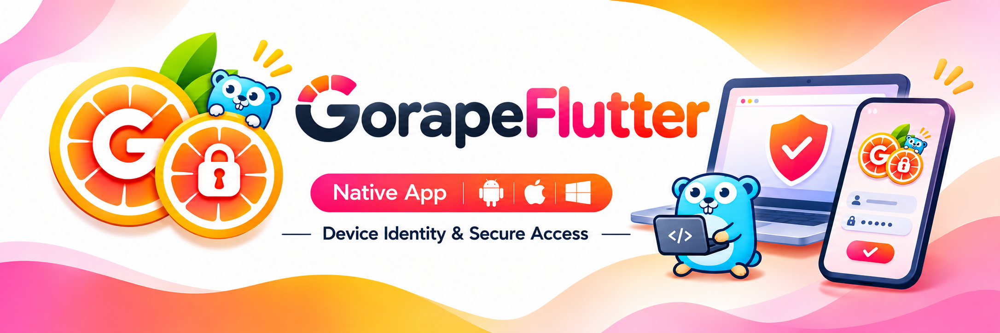

<p align="center">
  
</p>

# gf-app — Gorape Flutter client

Flutter client for the [Gorape](../gorape) device trust / attestation backend.
The app signs in with Keycloak (Authorization Code + PKCE), calls the Gorape
OpenAPI 3.1 API with the **access token**, and registers a separate Gorape RP
passkey through WebAuthn. The full credential/attestation response is verified
by Gorape; the legacy Android Keystore registration API remains available for
compatibility.

The backend repository remains the single source of truth. This project does not
fork or edit the Gorape Docker environment; it adds Compose overrides and
development scripts that layer on top of it.

## What is implemented

- Keycloak login for Android, iOS and macOS via `flutter_appauth`
  (public client, PKCE S256, `openid profile`, audience `gorape-api`).
- Keycloak login on Windows/Linux/Web via system-browser or browser redirect
  Authorization Code + PKCE with ID-token validation.
- Access-token-only Gorape API client. The ID token is never sent to Gorape.
  An expired access token triggers one refresh-and-retry instead of dropping the
  session.
- Project, device, registration, proof and attestation endpoints from
  `gorape/docs/openapi/openapi.yaml`, including Gorape RP WebAuthn registration
  and assertion.
- Group and role management endpoints (group CRUD, group devices, project /
  group role bindings) from the same contract.
- Role-aware UI driven by Keycloak token claims: cluster (realm) overview,
  per-project management and per-group management. Viewers get read-only
  screens; editors can register/revoke devices and assign group devices; admins
  can also create/edit/delete groups and grant project/group roles.
- Device registration and proof use the `passkeys` 2.23.2 Flutter plugin on
  Android, iOS, macOS, Windows and Web. Attestation presence/format is
  provider-dependent and is never inferred by the client.
- Linux uses the gf-app WebAuthn ceremony page in Chrome/Firefox; Gorape exposes
  only one-time challenge APIs and does not serve an end-user UI.
- Explicit platform support matrix in the UI and live legacy-verifier capabilities.
- Legacy local-only policy preferences remain informational; WebAuthn attestation
  acceptance is controlled by the Gorape server config, never by client policy.
- Automated tests for API contracts, role claim resolution, settings, local
  policy, registration and proof orchestration.

## Requirements

- Flutter 3.38+/Dart 3.10+ (developed with Flutter 3.38.2 / Dart 3.10).
- Docker Desktop with Docker Compose **v2.24 or newer** (the overrides use
  `!reset` / `!override`).
- The Gorape backend checkout, by default as a sibling directory:
  `../gorape`.
- Android SDK plus a connected emulator or physical device for Android work.
- Xcode for iOS/macOS builds (not installed/validated in this environment).

## Quick start (local backend build)

```bash
cd gf-app

# 1. Download Google's Android Key Attestation roots and generate a server
#    config that points at them. Files go to git-ignored config/generated/.
./scripts/generate-android-trust-config.sh

# 2. Generate a local HTTPS CA/server certificate (private keys are ignored).
./scripts/generate-local-tls.sh

# 3. Build/start postgres, redis, keycloak and the Gorape server from ../gorape.
./scripts/gorape-up.sh --https --android-attestation

# 4. A fresh local stack imports the Keycloak realm and seeds the demo project
#    and permission fixtures from configuration files. No API bootstrap step.
# 5. Run on a connected Android device. The script trusts the local CA in the
#    debug Dart client and adb-reverses the HTTPS API and Keycloak issuer.
./scripts/run-android.sh
```

## Diagnostic logging

Debug builds emit structured JSON diagnostics through `dart:developer`. On
Android, view them in Android Studio Logcat or with `flutter logs`; entries carry
a stable logger MCode such as `FAPI002` or `FPKY004`. Release builds suppress
these logs by default. To opt in for a diagnostic release build:

```bash
flutter build apk --release \
  --dart-define=GF_APP_LOG_ENABLED=true \
  --dart-define=GF_APP_LOG_LEVEL=INFO
```

`GF_APP_LOG_LEVEL` accepts `DEBUG`, `INFO`, `WARN`, `ERROR` or `FATAL`.
Structured JSON is on by default; `GF_APP_LOG_STRUCTURED=false` selects readable
text output. Authorization material, WebAuthn credentials/challenges/signatures,
request bodies and resource IDs are not logged; sensitive field names and
token-shaped strings are redacted as a defense in depth.

The default Android API endpoint is `https://localhost:8443`. To check it
outside the app, use the generated CA explicitly:

```bash
curl --cacert config/generated/tls/ca.crt https://localhost:8443/health
```

The CA/server private keys are mode `0600` and live only in the Git-ignored
`config/generated/tls/` directory. This self-signed certificate is for local
API transport only. Android Credential Manager uses the separate RP ID
`gorapeflutter.github.io`, with its public Digital Asset Links statement served
from the organization Pages repository. The statement includes both
`delegate_permission/common.get_login_creds` and
`delegate_permission/common.handle_all_urls` for package
`com.gorapeflutter.gf_app`. Google Password Manager registration was verified on
Pixel 6 with the current debug signing key. The API may remain on local HTTPS;
the RP association is fetched from the Pages domain.

Keycloak redirects, passwordless WebAuthn, the passkey-only login flow, AMR
mapper, and test users/groups are declared in
`../gorape/etc/keycloak/gorape-realm.json`. Gorape's `demo` project and
role/group bindings are seeded by PostgreSQL's `docker-entrypoint-initdb.d`
files. Keycloak import and PostgreSQL initialization run only for a fresh local
database; recreating the tmpfs Postgres container also resets Keycloak users and
their passkeys, which must be registered again.

Check that the legacy Android Key Attestation verifier is active:

```bash
curl --cacert config/generated/tls/ca.crt https://localhost:8443/health
# {"service":"gorape","status":"ok"}

TOKEN=$(cat ../gorape/etc/.gorape/client/admin/access_token)
curl -s -H "Authorization: Bearer $TOKEN" \
  --cacert config/generated/tls/ca.crt \
  https://localhost:8443/v1/projects/805c5265-7315-420b-8aa7-3aea715ed88a/attestation/capabilities
# {"verifiers":{"android":"implemented","ios":"unsupported", ...}}
```

The project ID above is available only in a database that was seeded with the
development data. A fresh Compose database requires the bootstrap step above;
then use an ID returned by `GET /v1/projects`.

`--android-attestation` configures only the legacy Android Keystore verifier; it
does not enable WebAuthn passkey attestation. Before passkey registration,
apply Gorape migration `000003_webauthn`, configure a stable WebAuthn RP ID and
exact origins, explicitly allow formats and mount their trust anchors. The
default empty allowlist rejects registration. Android also needs Digital Asset
Links for that RP domain. See [setup](docs/en/SETUP.md).

## Using the published Docker Hub image

The image is an override; the backend compose file is untouched.

```bash
# Floating latest (fine for experiments)
./scripts/gorape-up.sh --hub --android-attestation

# Recommended: pin a published tag or digest
GORAPE_SERVER_IMAGE=gorapeflutter/gorape:sha-7d9703b \
  ./scripts/gorape-up.sh --hub --pull --android-attestation
```

Available tags are visible on Docker Hub (`latest`, `main`, `sha-…`). The
override sets `image` and removes the local `build` section with
`build: !reset null`.

## Configuration

Runtime defaults:

| Setting | Default | Notes |
| --- | --- | --- |
| API base URL | `https://localhost:8443` | Local TLS listener; Android runner uses `adb reverse` and debug-only CA trust |
| OIDC issuer | `http://localhost:8080/realms/gorape` | Must exactly match Keycloak's `iss` |
| Client ID | `gorape-client` | Public client, PKCE only |
| Android/iOS/macOS redirect | `com.gorapeflutter.gfapp:/oauth2redirect` | Registered on the Keycloak client |
| Windows/Linux redirect | `http://127.0.0.1:8401/oauth2redirect` | System-browser loopback callback |
| Web redirect | Same-origin `/auth.html` | Local dev default: `http://localhost:5000/auth.html` |
| Scopes | `openid profile` | Audience `gorape-api` comes from a mapper |

Override at build/run time with `--dart-define`:

```bash
flutter run \
  --dart-define=GORAPE_API_BASE_URL=https://api.example.com \
  --dart-define=GORAPE_OIDC_ISSUER=https://keycloak.example.com/realms/gorape \
  --dart-define=GORAPE_OIDC_CLIENT_ID=gorape-client \
  --dart-define=GORAPE_OIDC_REDIRECT_URI=http://127.0.0.1:8401/oauth2redirect
```

Override the redirect URI per target deployment. The Keycloak public client must
allow each target's exact redirect URI; Web deployments must also add the Web
origin to `webOrigins` for discovery/token CORS.

Values can also be edited in the app under **Settings**. They are stored in the
OS secure storage, not in the Gorape backend.

The app language can be changed under **Settings → Display language**. Japanese
and English are supported; the selection is stored locally and defaults to
Japanese.

> The OIDC issuer must remain identical to the issuer that Keycloak puts in the
> token. Replacing only the host (for example using `10.0.2.2` for the issuer)
> makes token validation fail. Use `adb reverse tcp:8080 tcp:8080` or a proper
> hostname with matching Keycloak hostname configuration instead.

## API surface

Only endpoints present in the backend OpenAPI contract are used:

| Method | Path |
| --- | --- |
| GET | `/health` |
| GET | `/v1/projects` |
| GET | `/v1/projects/{projectId}` |
| GET | `/v1/projects/{projectId}/devices` |
| GET | `/v1/projects/{projectId}/devices/{deviceId}` |
| DELETE | `/v1/projects/{projectId}/devices/{deviceId}` |
| POST | `/v1/projects/{projectId}/devices/registration/challenge` |
| POST | `/v1/projects/{projectId}/devices/registration/verify` |
| POST | `/v1/projects/{projectId}/devices/passkeys/registration/options` |
| POST | `/v1/projects/{projectId}/devices/passkeys/registration/verify` |
| POST | `/v1/projects/{projectId}/devices/{deviceId}/challenge` |
| POST | `/v1/projects/{projectId}/devices/{deviceId}/verify` |
| POST | `/v1/projects/{projectId}/devices/{deviceId}/passkeys/authentication/options` |
| POST | `/v1/projects/{projectId}/devices/{deviceId}/passkeys/authentication/verify` |
| GET | `/v1/projects/{projectId}/attestation/capabilities` |
| GET | `/v1/projects/{projectId}/devices/{deviceId}/attestation` |
| GET/POST | `/v1/projects/{projectId}/groups` |
| GET/PATCH/DELETE | `/v1/projects/{projectId}/groups/{groupId}` |
| GET/POST | `/v1/projects/{projectId}/groups/{groupId}/devices` |
| DELETE | `/v1/projects/{projectId}/groups/{groupId}/devices/{deviceId}` |
| GET/POST | `/v1/projects/{projectId}/roles` |
| DELETE | `/v1/projects/{projectId}/roles/{bindingId}` |
| GET/POST | `/v1/projects/{projectId}/groups/{groupId}/roles` |
| DELETE | `/v1/projects/{projectId}/groups/{groupId}/roles/{bindingId}` |

Passkey registration and device proof use Gorape's separate WebAuthn RP
endpoints. Keycloak passkeys remain Keycloak credentials and cannot be reused
for Gorape because their RP IDs differ. The legacy Android Keystore endpoints
remain available for compatibility; the device registration UI uses the
WebAuthn flow.

## Role-aware UI (Keycloak claims)

The **管理** tab has three scopes: クラスタ (Keycloak realm), プロジェクト and
グループ. Roles are resolved client-side from the access token for display and
action gating. The backend is authoritative and combines Gorape project/group
role bindings with configured Keycloak roles and group-path claims when
authorizing requests.

Supported claim conventions (all optional):

| Claim | Meaning |
| --- | --- |
| `realm_access.roles` / `resource_access.*.roles` | `admin`, `editor`, `viewer` (the seeded `app` role maps to `viewer`; `owner` maps to `admin`) |
| `gorape_cluster_role` | Explicit realm-wide role |
| `gorape_project_role` | Project-wide fallback role |
| `gorape_project_roles` | JSON object keyed by project slug/id |
| `gorape_project_<slug>_role` | Per-project user attribute |
| `gorape_group_role` | Group-wide fallback role |
| `gorape_group_roles` | JSON object keyed by group slug/path |
| `gorape_group_<slug>_role` | Per-group user attribute (for example `gorape_group_group001_role: ["owner"]`) |
| `groups` | Group paths; `/group004/editor` also assigns a role |

The seeded realm (`../gorape/etc/keycloak/gorape-realm.json`) maps `groups` plus
every `gorape_group_<slug>_role` user attribute into the `gorape-client` access
token. Realms configured by hand need those mappers added to the client:

- **Group Membership** mapper → claim `groups`, full path, access token.
- One **User Attribute** mapper per group attribute → claim name equal to the
  attribute name, multivalued, access token.

Role changes take effect after the next token refresh or sign-in. Realm roles are
the quickest way to switch the whole UI: grant `admin`, `editor` or `viewer`
(realm roles `editor` and `viewer` are included in the seed realm).

## OS support

Client/plugin and legacy-verifier capabilities:

| Platform | Keycloak login | Gorape passkey ceremony | Legacy OS key | Legacy Gorape verifier |
| --- | --- | --- | --- | --- |
| Android | Yes | Yes | Yes (Credential Manager/provider-dependent) | `implemented` when legacy Android roots are configured |
| iOS | Yes | Yes (AuthenticationServices) | Legacy flow not implemented | Legacy verifier `unsupported` |
| macOS | Yes | Yes (AuthenticationServices) | Legacy flow not implemented | Legacy verifier `unsupported` |
| Windows | Yes (system browser + PKCE) | Yes (Windows WebAuthn API) | Legacy flow not implemented | Legacy verifier `unsupported` |
| Linux | Yes (system browser + PKCE) | Yes (gf-app browser ceremony page) | No | Legacy verifier `unsupported` |
| Web | Yes (browser redirect + PKCE) | Yes (browser WebAuthn API) | Legacy flow not implemented | Legacy verifier `unsupported` |

The passkeys Flutter plugin returns the full WebAuthn credential response on
Android, iOS, macOS, Windows, and Web, but an `attestation: direct` request is a
preference, not a guarantee. Providers may return `none`; Apple platform
credentials do not expose a conveyance preference through the plugin. Gorape
validates the actual `fmt` and trust chain and applies default-deny policy.
Linux's native passkeys plugin is unavailable, so the gf-app web asset performs
the ceremony in Chrome/Firefox at the configured RP origin; Gorape remains
API-only. Windows/Web use their native/browser WebAuthn APIs.

Before deploying, configure one stable Gorape RP ID and associate the app with
that domain: Android Digital Asset Links, Apple AASA/`webcredentials` entitlements,
and an RP ID matching the Web origin. For Linux browser handoff, set
`Application.Server.WebAuthn.portal_origin` to the gf-app web origin,
`browser_api_origin` to Gorape's public API origin, and allow the portal origin
in `Application.Server.web_origins` for CORS. Add exact WebAuthn origins to
`rp_origins`. These platform associations are separate from Keycloak's setup.

## Project layout

```
lib/
  config/           Runtime configuration defaults
  controller/       Riverpod controllers and dependency injection for the UI
  entity/           Model, request, and response definitions
  usecase/          Authentication, device registration, proof, and app workflows
  repository/       HTTP, AppAuth, secure storage, MethodChannel, and platform adapters
  share/            Shared exceptions and stateless transformations
  ui/               Login, devices, registration, management, support, settings
android/            MainActivity.kt Keystore/attestation MethodChannel bridge
docker/             gf-app Compose overrides (backend files are not edited)
scripts/            Backend, Keycloak, trust-anchor and Android dev helpers
test/               Unit/widget tests
```

As in `cmn-core`, layers are split by concept (`project.dart`, `device.dart`,
`attestation.dart`, and so on). Repositories, use cases, and controllers keep
their public interfaces, implementations, and constructors together. UI
processing starts through controllers.

## Development checks

```bash
./scripts/check.sh          # format check + dart analyze + flutter test
./scripts/check.sh --apk    # additionally build the debug APK
```

`dart analyze` is used instead of `flutter analyze`: in this SDK build
`flutter analyze` crashes because the `analysis_server.dart.snapshot` file is
missing while the AOT snapshot exists.

## Security notes

- Local development uses HTTP. Release builds must use HTTPS for the API and
  Keycloak, and a registered HTTPS or platform-native redirect URI.
- Only the access token is sent to Gorape. The ID token is kept for sign-out
  hints and never used as an API bearer token.
- Passkey private keys remain in the OS/browser credential provider. The app
  forwards the complete WebAuthn response; Gorape verifies before persisting the
  credential public key and removes the raw attestation evidence from the stored
  credential record.
- The legacy Android Keystore flow still keeps private keys in Keystore and
  sends its public key/certificate chain to Gorape.
- `config/generated/` is git-ignored because it contains machine-specific
  absolute paths and downloaded trust anchors.
- The bundled Keycloak admin credentials (`admin` / `admin`) and seeded user
  passwords are development-only. Never reuse them outside local development.

## Known limitations

- Real passkey attestation is provider-dependent. Android may return
  `android-key` or `none`; Windows may or may not return TPM attestation; Apple
  may return an anonymous `apple` statement or `none`; browsers can anonymize.
  Default policy rejects `none`, unconfigured formats, and untrusted chains.
- iOS/macOS builds could not be validated here because Xcode is incomplete.
- Linux browser handoff requires Gorape's RP ceremony page and a matching
  `portal_origin`; Windows/Web use the platform/browser WebAuthn APIs.
- The backend has no policy API; the policy screen is explicitly local-only.
- Gorape has no cluster-wide or "my role" API. The クラスタ screen is built from
  Keycloak claims and the projects visible to the signed-in user; per-project and
  per-group role bindings are only listed for callers the backend already allows.
- Swagger UI/godoc are optional containers (`make docs` in the backend).

## Further documentation

- The mdBook documentation is published as separate English and Japanese books
  at `https://gorapeflutter.github.io/gf-app/en/` and
  `https://gorapeflutter.github.io/gf-app/jp/`, each with an independent table
  of contents. The root URL is a language chooser. Install the tools and build
  both books:
  ```bash
  cargo install mdbook
  cargo install mdbook-mermaid
  scripts/docs/build-book.sh
  ```
  Open `build/docs-site/index.html` to choose a language, or open the `en/` and
  `jp/` subdirectories directly.
- Before the first deployment, a repository administrator must enable Pages in
  **Settings → Pages → Build and deployment → Source → GitHub Actions**. GitHub
  does not allow the workflow's `GITHUB_TOKEN` to create the Pages site. After
  this one-time setup, the workflow builds on pull requests and deploys pushes
  to `main` at `https://gorapeflutter.github.io/gf-app/`.
- `scripts/docs/link_gf_ids.py` links documentation IDs to their source-comment
  line on GitHub. It skips fenced diagrams; run it after moving ID comments.
- English chapter sources: [`docs/en/`](docs/en/)
- 日本語章のソース: [`docs/jp/`](docs/jp/)
