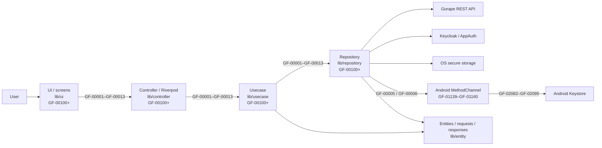
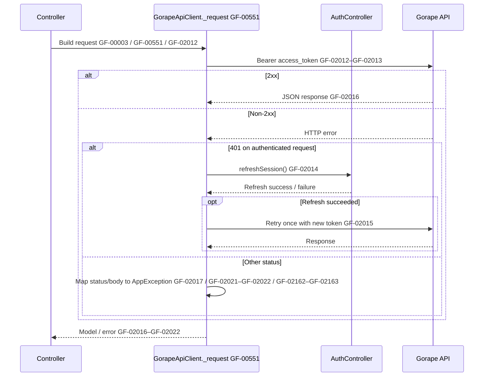
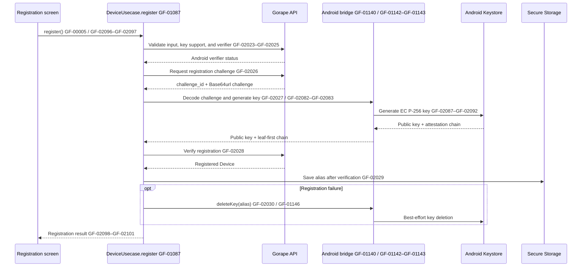
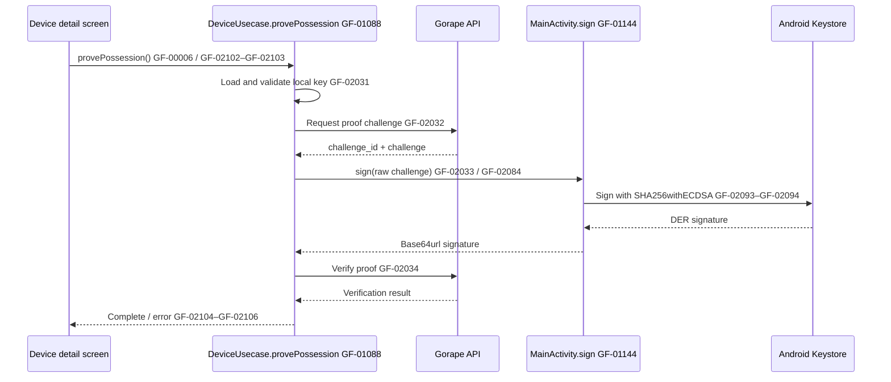
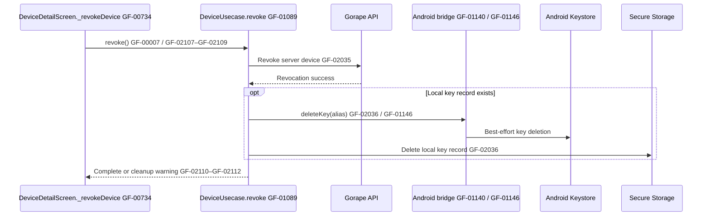
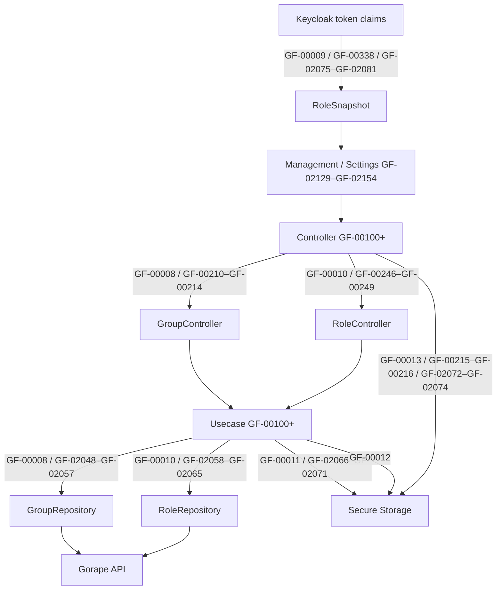

# Architecture and process flows

This guide explains how application processing connects the UI to external
services. IDs in the diagrams match the English source comments.

- [GF-00001](https://github.com/Gorapeflutter/gf-app/blob/main/lib/app.dart#L39)–[GF-00013](https://github.com/Gorapeflutter/gf-app/blob/main/lib/controller/language.dart#L12): end-to-end application flows
- [GF-00100](https://github.com/Gorapeflutter/gf-app/blob/main/lib/app.dart#L14)–[GF-01160](https://github.com/Gorapeflutter/gf-app/blob/main/android/app/src/main/kotlin/com/gorapeflutter/gf_app/MainActivity.kt#L43): handwritten Dart and Android functions/callbacks
- [GF-02000](https://github.com/Gorapeflutter/gf-app/blob/main/lib/usecase/auth.dart#L48)–[GF-02166](https://github.com/Gorapeflutter/gf-app/blob/main/lib/usecase/device.dart#L298): logical steps inside multi-stage functions
- Tests and generated code are not included.

See the [function ID index](FUNCTION_INDEX.md) and
[processing-step ID index](PROCESS_INDEX.md) for the complete lists.

## Layers



Function IDs span [GF-00100](https://github.com/Gorapeflutter/gf-app/blob/main/lib/app.dart#L14)–[GF-01160](https://github.com/Gorapeflutter/gf-app/blob/main/android/app/src/main/kotlin/com/gorapeflutter/gf_app/MainActivity.kt#L43); function-step IDs span
[GF-02000](https://github.com/Gorapeflutter/gf-app/blob/main/lib/usecase/auth.dart#L48)–[GF-02166](https://github.com/Gorapeflutter/gf-app/blob/main/lib/usecase/device.dart#L298). The indexes map IDs to symbols and source files.

- **UI** renders screens and gathers user input. It starts application work through a Controller.
- **Controller** owns Riverpod state, calls Usecases, and invalidates dependent providers after updates.
- **Usecase** composes application workflows, including operations that coordinate multiple repositories.
- **Repository** forms the boundary to HTTP, OIDC, secure storage, and native APIs.
- **Entity** defines the data passed between layers.

## End-to-end flow IDs

| ID | Flow | Main implementation |
| --- | --- | --- |
| [GF-00001](https://github.com/Gorapeflutter/gf-app/blob/main/lib/app.dart#L39) | Startup, settings load, session restoration, and screen routing | `lib/app.dart`, `lib/controller/auth.dart`, `lib/usecase/auth.dart` |
| [GF-00002](https://github.com/Gorapeflutter/gf-app/blob/main/lib/controller/auth.dart#L72) | Keycloak sign-in/sign-out and local session management | `lib/controller/auth.dart`, `lib/usecase/auth.dart`, `lib/repository/auth.dart` |
| [GF-00003](https://github.com/Gorapeflutter/gf-app/blob/main/lib/repository/gorape.dart#L531) | Gorape API requests, Bearer token, one refresh-and-retry after 401 | `lib/repository/gorape.dart` |
| [GF-00004](https://github.com/Gorapeflutter/gf-app/blob/main/lib/controller/project.dart#L12) | Read projects, devices, groups, and attestation data | `lib/controller/project.dart`, `device.dart`, `group.dart`, `attestation.dart` |
| [GF-00005](https://github.com/Gorapeflutter/gf-app/blob/main/lib/usecase/device.dart#L89) | Android device registration and Key Attestation verification | `lib/usecase/device.dart`, `lib/repository/device_key.dart`, `MainActivity.kt` |
| [GF-00006](https://github.com/Gorapeflutter/gf-app/blob/main/lib/usecase/device.dart#L190) | Prove device possession using its private key | `lib/usecase/device.dart`, `lib/repository/device_key.dart`, `MainActivity.kt` |
| [GF-00007](https://github.com/Gorapeflutter/gf-app/blob/main/lib/usecase/device.dart#L244) | Revoke a device on the server and clean up local key data | `lib/usecase/device.dart` |
| [GF-00008](https://github.com/Gorapeflutter/gf-app/blob/main/lib/controller/group.dart#L71) | Create/update/delete groups and assign devices | `lib/controller/group.dart`, `lib/usecase/group.dart`, `lib/repository/group.dart` |
| [GF-00009](https://github.com/Gorapeflutter/gf-app/blob/main/lib/controller/role.dart#L11) | Resolve UI roles from Keycloak token claims | `lib/controller/role.dart`, `lib/entity/model/role.dart` |
| [GF-00010](https://github.com/Gorapeflutter/gf-app/blob/main/lib/controller/role.dart#L118) | Manage Gorape project/group role bindings | `lib/controller/role.dart`, `lib/usecase/role.dart`, `lib/repository/role.dart` |
| [GF-00011](https://github.com/Gorapeflutter/gf-app/blob/main/lib/controller/connection.dart#L29) | Read/write connection settings and check Gorape health | `lib/controller/connection.dart`, `lib/usecase/connection.dart` |
| [GF-00012](https://github.com/Gorapeflutter/gf-app/blob/main/lib/controller/policy.dart#L11) | Read/write local-only device policy preferences | `lib/controller/policy.dart`, `lib/usecase/policy.dart` |
| [GF-00013](https://github.com/Gorapeflutter/gf-app/blob/main/lib/controller/language.dart#L12) | Read/write the app display language | `lib/controller/language.dart` |

These IDs describe application processing. They do not represent backend API
features or authorization grants.

## Startup and authentication

[GF-00001](https://github.com/Gorapeflutter/gf-app/blob/main/lib/app.dart#L39) loads connection settings and restores credentials from secure
storage. A valid session opens the app shell; otherwise the login screen appears.
An expired session may be refreshed before routing to login. [GF-00002](https://github.com/Gorapeflutter/gf-app/blob/main/lib/controller/auth.dart#L72) covers
interactive sign-in and sign-out.

```mermaid
sequenceDiagram
    actor User
    participant App as AuthGate GF-00103
    participant Config as ConnectionUsecase.load GF-01065
    participant Auth as AuthUsecase.restore/signIn GF-01055–GF-01056
    participant Store as Secure Storage
    participant UI as AppShell / LoginScreen
    User->>App: Launch GF-00001 / GF-02037
    App->>Config: Load settings GF-02066–GF-02068
    Config->>Store: Read saved settings GF-02067
    App->>Auth: Restore saved session GF-00001 / GF-00135
    Auth->>Store: Read and decode tokens GF-02000
    alt Valid session GF-02002
        Auth-->>App: AuthSession
        App-->>UI: Show AppShell GF-02040
    else Malformed token
        Auth->>Store: Delete malformed session GF-02001
        App-->>UI: Show LoginScreen GF-02041
    else Expired token
        opt Refresh token available GF-02003
            Auth->>Store: Save refreshed tokens
            Auth-->>App: AuthSession
            App-->>UI: Show AppShell GF-02040
        else Refresh unavailable or failed GF-02004
            Auth->>Store: Delete expired session
            App-->>UI: Show LoginScreen GF-02041
        end
    else No saved session
        Auth-->>App: null
        App-->>UI: Show LoginScreen GF-02041
    end
    User->>UI: Sign in GF-00002
    UI->>Auth: signIn() GF-00136 / GF-02005–GF-02006
    Auth->>Store: Save tokens GF-02007
    Auth-->>App: AuthSession
    App-->>UI: Show AppShell GF-02040
```

## Authenticated API requests

[GF-00003](https://github.com/Gorapeflutter/gf-app/blob/main/lib/repository/gorape.dart#L531) sends only the Keycloak **access token** as the Bearer token. On a
401 response, the client attempts one refresh and, if successful, retries the
original request once. The ID token is never sent to Gorape.



## Android registration, proof, and revocation

Registration binds the raw server challenge to an Android Keystore key. The
private key never leaves the device; the app submits the public key and a
leaf-first certificate chain. If verification fails, the generated key is
deleted on a best-effort basis.



Possession proof ([GF-00006](https://github.com/Gorapeflutter/gf-app/blob/main/lib/usecase/device.dart#L190)) obtains a fresh challenge, signs its raw bytes
inside Keystore, and submits the ASN.1/DER signature for server verification.





## Management data and local preferences

- [GF-00004](https://github.com/Gorapeflutter/gf-app/blob/main/lib/controller/project.dart#L12): List/detail providers call Usecases through Controllers; repositories fetch data from Gorape. Controllers invalidate dependent providers after updates.
- [GF-00008](https://github.com/Gorapeflutter/gf-app/blob/main/lib/controller/group.dart#L71): Group changes and device assignments are persisted by Gorape.
- [GF-00009](https://github.com/Gorapeflutter/gf-app/blob/main/lib/controller/role.dart#L11): Roles derived from token claims gate UI visibility only. Gorape remains authoritative for authorization.
- [GF-00010](https://github.com/Gorapeflutter/gf-app/blob/main/lib/controller/role.dart#L118): Gorape role bindings are separate data from the client-side claims projection in [GF-00009](https://github.com/Gorapeflutter/gf-app/blob/main/lib/controller/role.dart#L11).
- [GF-00011](https://github.com/Gorapeflutter/gf-app/blob/main/lib/controller/connection.dart#L29): Connection settings are stored securely; health checks use the configured API URL.
- [GF-00012](https://github.com/Gorapeflutter/gf-app/blob/main/lib/controller/policy.dart#L11): Policy preferences are local-only; the current backend has no policy API.
- [GF-00013](https://github.com/Gorapeflutter/gf-app/blob/main/lib/controller/language.dart#L12): The selected display language is stored securely and applied through Riverpod state.



## Finding an implementation

Search for IDs in source with `rg "GF-" lib android`. The repository README
also describes the layers.
