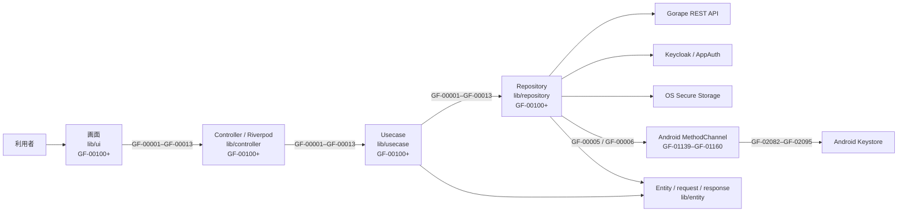
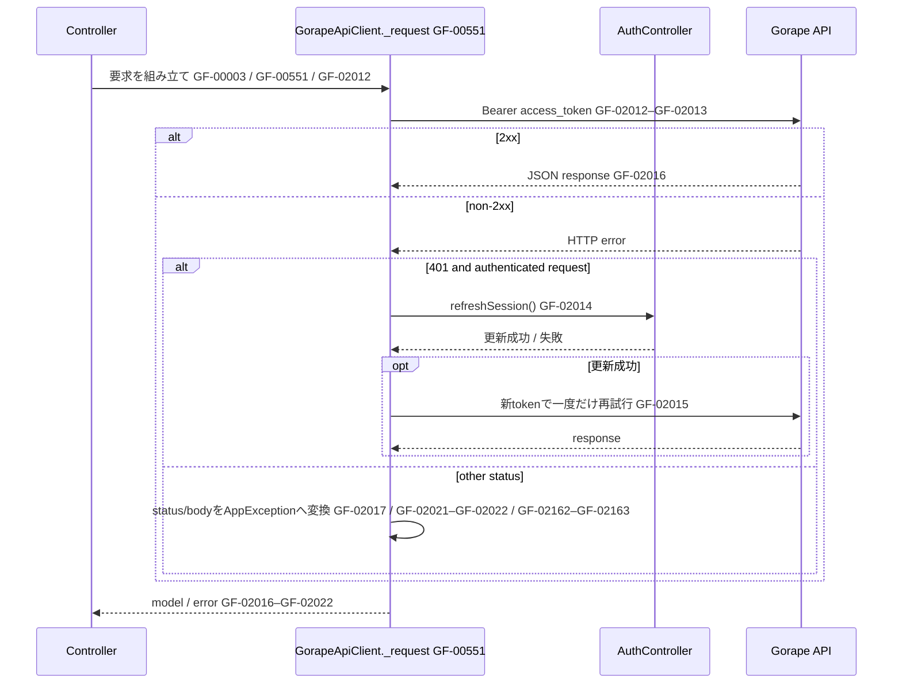
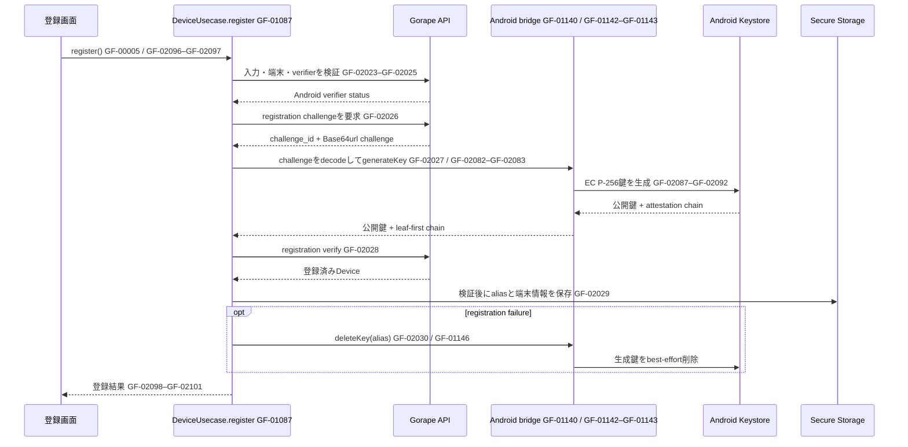
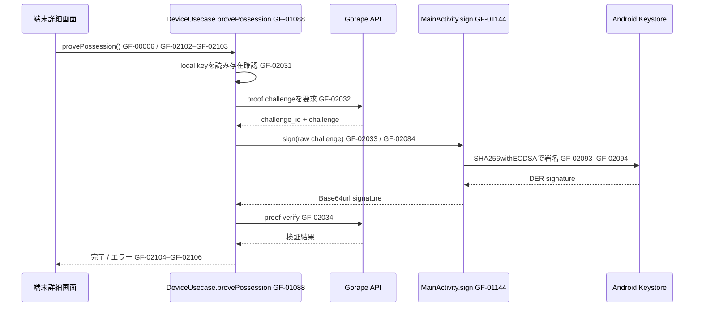
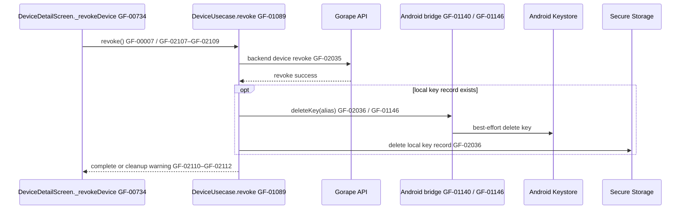
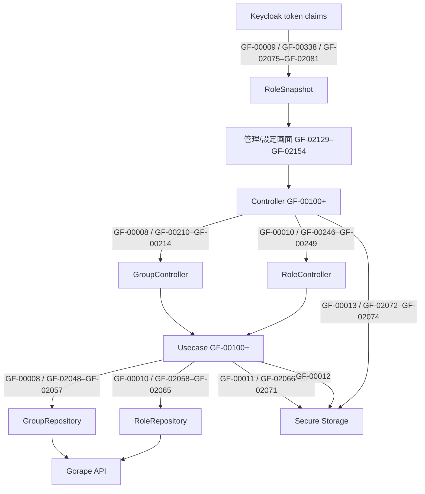

# アーキテクチャと処理フロー

この文書は、アプリ内の処理を `GF-XXXXX` のIDで識別し、UIから外部サービスまでのつながりを説明します。ソースの処理内容は変更せず、ID付きの英語コメントを追加しています。

- [GF-00001](https://github.com/Gorapeflutter/gf-app/blob/main/lib/app.dart#L39)〜[GF-00013](https://github.com/Gorapeflutter/gf-app/blob/main/lib/controller/language.dart#L12): エンドツーエンドの処理フロー
- [GF-00100](https://github.com/Gorapeflutter/gf-app/blob/main/lib/app.dart#L14)〜: 手書きのDart関数・メソッド・getter/setter・constructor・callback
- [GF-02000](https://github.com/Gorapeflutter/gf-app/blob/main/lib/usecase/auth.dart#L48)〜: 複数段階の関数内にある論理的な処理ステップ
- Kotlinネイティブ関数も関数ID一覧に含みます。テスト・生成コードは対象外です。

関数IDの全件は [`FUNCTION_INDEX.md`](FUNCTION_INDEX.md)、関数内ステップIDは [`PROCESS_INDEX.md`](PROCESS_INDEX.md) を参照してください。

## レイヤー構成



関数IDは全レイヤーで [GF-00100](https://github.com/Gorapeflutter/gf-app/blob/main/lib/app.dart#L14)〜[GF-01160](https://github.com/Gorapeflutter/gf-app/blob/main/android/app/src/main/kotlin/com/gorapeflutter/gf_app/MainActivity.kt#L43)、関数内ステップIDは [GF-02000](https://github.com/Gorapeflutter/gf-app/blob/main/lib/usecase/auth.dart#L48)〜[GF-02166](https://github.com/Gorapeflutter/gf-app/blob/main/lib/usecase/device.dart#L298) です。各IDの関数名と担当ファイルは一覧を参照してください。

- **UI** は表示とユーザー入力を担当します。画面から業務処理を開始するときはControllerを呼び出します。
- **Controller** はRiverpodの状態を管理し、Usecaseを呼び出します。更新後は関連するProviderをinvalidateして再取得します。
- **Usecase** はアプリケーション処理を組み立てます。端末登録のような複数のRepositoryにまたがる処理もここに置きます。
- **Repository** はHTTP、OIDC、Secure Storage、ネイティブ機能との境界です。
- **Entity** はレイヤー間で受け渡すデータを定義します。

## 処理ID一覧

| ID | 処理 | 主な実装 |
| --- | --- | --- |
| [GF-00001](https://github.com/Gorapeflutter/gf-app/blob/main/lib/app.dart#L39) | 起動、接続設定の読み込み、保存済みセッションの復元、画面分岐 | `lib/app.dart`, `lib/controller/auth.dart`, `lib/usecase/auth.dart` |
| [GF-00002](https://github.com/Gorapeflutter/gf-app/blob/main/lib/controller/auth.dart#L72) | Keycloakへのサインイン/サインアウトとローカルセッション管理 | `lib/controller/auth.dart`, `lib/usecase/auth.dart`, `lib/repository/auth.dart` |
| [GF-00003](https://github.com/Gorapeflutter/gf-app/blob/main/lib/repository/gorape.dart#L531) | Gorape API呼び出し、Bearer token付与、401時の一度だけの更新・再試行 | `lib/repository/gorape.dart` |
| [GF-00004](https://github.com/Gorapeflutter/gf-app/blob/main/lib/controller/project.dart#L12) | プロジェクト、端末、グループ、Attestationデータの読み込み | `lib/controller/project.dart`, `lib/controller/device.dart`, `lib/controller/group.dart`, `lib/controller/attestation.dart` |
| [GF-00005](https://github.com/Gorapeflutter/gf-app/blob/main/lib/usecase/device.dart#L89) | Android端末登録とKey Attestation検証 | `lib/usecase/device.dart`, `lib/repository/device_key.dart`, `android/app/src/main/kotlin/com/gorapeflutter/gf_app/MainActivity.kt` |
| [GF-00006](https://github.com/Gorapeflutter/gf-app/blob/main/lib/usecase/device.dart#L190) | 登録済み端末の秘密鍵による所有証明 | `lib/usecase/device.dart`, `lib/repository/device_key.dart`, `MainActivity.kt` |
| [GF-00007](https://github.com/Gorapeflutter/gf-app/blob/main/lib/usecase/device.dart#L244) | 端末のサーバー側失効とローカル鍵情報の後片付け | `lib/usecase/device.dart` |
| [GF-00008](https://github.com/Gorapeflutter/gf-app/blob/main/lib/controller/group.dart#L71) | グループの作成/更新/削除と端末の割り当て | `lib/controller/group.dart`, `lib/usecase/group.dart`, `lib/repository/group.dart` |
| [GF-00009](https://github.com/Gorapeflutter/gf-app/blob/main/lib/controller/role.dart#L11) | Keycloak token claimsからのUI向けロール解決 | `lib/controller/role.dart`, `lib/entity/model/role.dart` |
| [GF-00010](https://github.com/Gorapeflutter/gf-app/blob/main/lib/controller/role.dart#L118) | Gorapeのプロジェクト/グループrole bindingの管理 | `lib/controller/role.dart`, `lib/usecase/role.dart`, `lib/repository/role.dart` |
| [GF-00011](https://github.com/Gorapeflutter/gf-app/blob/main/lib/controller/connection.dart#L29) | 接続設定の読み書きとGorape health check | `lib/controller/connection.dart`, `lib/usecase/connection.dart` |
| [GF-00012](https://github.com/Gorapeflutter/gf-app/blob/main/lib/controller/policy.dart#L11) | サーバーへ送信しない端末ポリシー設定の読み書き | `lib/controller/policy.dart`, `lib/usecase/policy.dart` |
| [GF-00013](https://github.com/Gorapeflutter/gf-app/blob/main/lib/controller/language.dart#L12) | アプリ表示言語の読み書き | `lib/controller/language.dart` |

IDは処理を説明するための参照番号です。バックエンドAPIの機能や権限を表すものではありません。

## 起動と認証

[GF-00001](https://github.com/Gorapeflutter/gf-app/blob/main/lib/app.dart#L39) は接続設定を読み込んだ後、Secure Storageの認証情報を復元します。復元できた場合はアプリ本体へ、できなければログイン画面へ進みます。期限切れでもrefresh tokenが利用可能なら、ログイン画面を表示する前に更新を試みます。

```mermaid
sequenceDiagram
    actor User as 利用者
    participant App as AuthGate GF-00103
    participant Config as ConnectionUsecase.load GF-01065
    participant Auth as AuthUsecase.restore/signIn GF-01055–GF-01056
    participant Store as Secure Storage
    participant UI as AppShell / LoginScreen
    User->>App: アプリ起動 GF-00001 / GF-02037
    App->>Config: 接続設定を読み込む GF-02066–GF-02068
    Config->>Store: 保存済み設定を読む GF-02067
    App->>Auth: 保存済みセッションを復元 GF-00001 / GF-00135
    Auth->>Store: tokenを読み・decode GF-02000
    alt 有効なsession GF-02002
        Auth-->>App: AuthSession
        App-->>UI: AppShellを表示 GF-02040
    else malformed token
        Auth->>Store: sessionを削除 GF-02001
        App-->>UI: LoginScreenを表示 GF-02041
    else expired token
        opt refresh tokenが使用可能 GF-02003
            Auth->>Store: 更新tokenを保存
            Auth-->>App: AuthSession
            App-->>UI: AppShellを表示 GF-02040
        else refresh不可 / refresh失敗 GF-02004
            Auth->>Store: 期限切れsessionを削除
            App-->>UI: LoginScreenを表示 GF-02041
        end
    else sessionなし
        Auth-->>App: null
        App-->>UI: LoginScreenを表示 GF-02041
    end
    User->>UI: ログイン GF-00002
    UI->>Auth: signIn() GF-00136 / GF-02005–GF-02006
    Auth->>Store: tokenを保存 GF-02007
    Auth-->>App: AuthSession
    App-->>UI: AppShellを表示 GF-02040
```

[GF-00003](https://github.com/Gorapeflutter/gf-app/blob/main/lib/repository/gorape.dart#L531) のAPI要求はKeycloakの**access token**だけをBearer tokenとして使います。401を受けた場合はセッション更新を一度だけ試し、成功した場合に元の要求を一度だけ再試行します。ID tokenはGorape APIに送信しません。



## Android端末登録と所有証明

登録では、サーバーが発行したchallengeの生バイト列をAndroid Keystoreの鍵生成に結び付けます。秘密鍵は端末外に出さず、公開鍵とleaf-firstの証明書チェーンをサーバーに提出します。登録検証に失敗した場合は、生成した鍵を可能な範囲で削除します。



所有証明（[GF-00006](https://github.com/Gorapeflutter/gf-app/blob/main/lib/usecase/device.dart#L190)）では、新しいchallengeを取得し、ローカルKeystoreの秘密鍵で生バイト列に署名します。署名はASN.1/DER形式を維持してサーバーで検証します。失効（[GF-00007](https://github.com/Gorapeflutter/gf-app/blob/main/lib/usecase/device.dart#L244)）はサーバー側の成功後にKeystore鍵とSecure Storage上の記録を削除します。





## 管理データとローカル設定

- [GF-00004](https://github.com/Gorapeflutter/gf-app/blob/main/lib/controller/project.dart#L12): 各一覧/詳細ProviderがControllerを通じてUsecaseを呼び出し、RepositoryからGorape APIのデータを取得します。画面操作でデータを変更した後は、Controllerが関連Providerをinvalidateします。
- [GF-00008](https://github.com/Gorapeflutter/gf-app/blob/main/lib/controller/group.dart#L71): グループ管理と端末割り当てはGorape APIへ反映されます。
- [GF-00009](https://github.com/Gorapeflutter/gf-app/blob/main/lib/controller/role.dart#L11): token claimsから解決したroleは表示や操作ボタンの制御に使われます。最終的な認可はGorapeバックエンドが行います。
- [GF-00010](https://github.com/Gorapeflutter/gf-app/blob/main/lib/controller/role.dart#L118): Gorapeに保存されたrole bindingの一覧/変更を扱います。[GF-00009](https://github.com/Gorapeflutter/gf-app/blob/main/lib/controller/role.dart#L11)のUI向けclaimsとは別のデータです。
- [GF-00011](https://github.com/Gorapeflutter/gf-app/blob/main/lib/controller/connection.dart#L29): 接続設定はSecure Storageに保存され、health checkは設定済みAPI URLへ要求します。
- [GF-00012](https://github.com/Gorapeflutter/gf-app/blob/main/lib/controller/policy.dart#L11): ポリシー設定は端末内だけに保存されます。現在のバックエンドにはpolicy APIがありません。
- [GF-00013](https://github.com/Gorapeflutter/gf-app/blob/main/lib/controller/language.dart#L12): 表示言語はSecure Storageに保存し、Riverpod stateを更新して画面に反映します。



## 実装をたどる

IDは実装コメントにも付与されています。`rg "GF-" lib android`で検索できます。Repositoryの配置はrepository rootのREADMEを参照してください。
