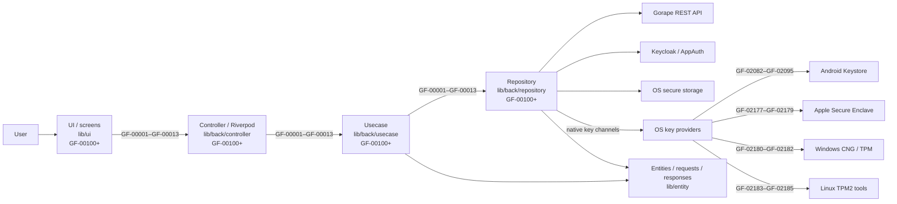
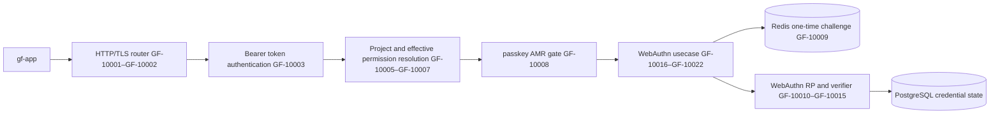
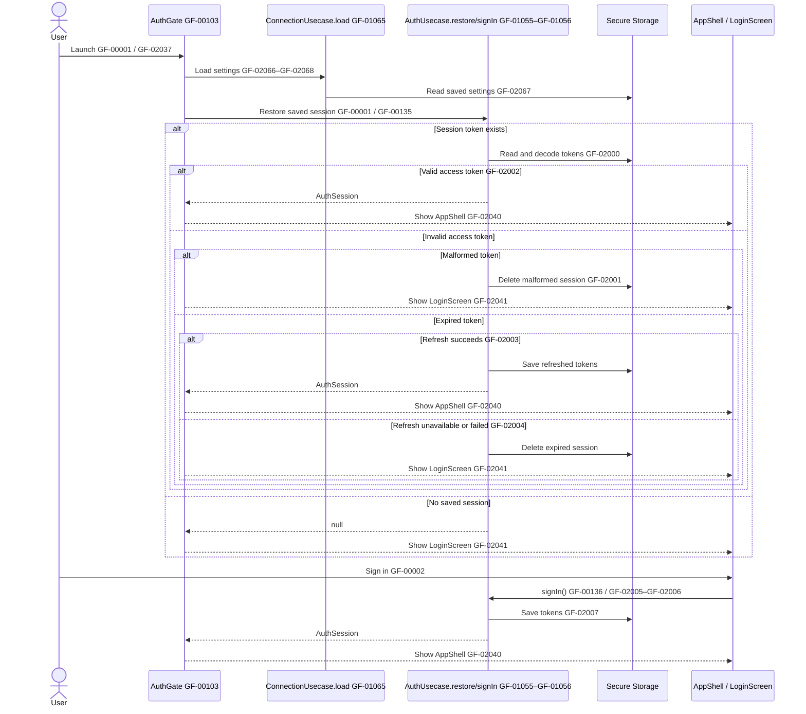
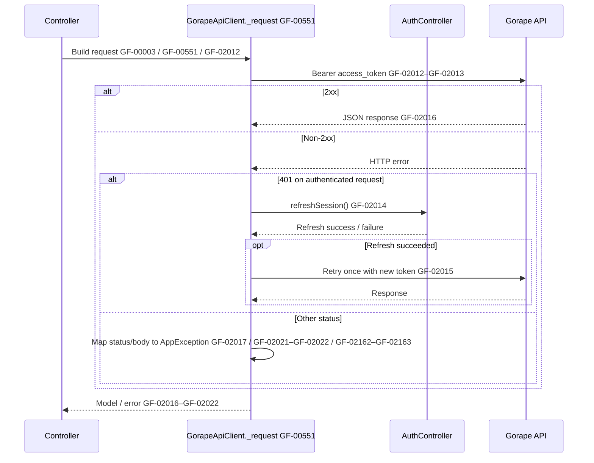
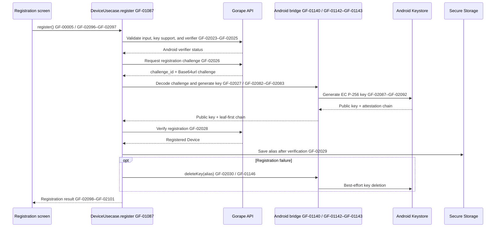
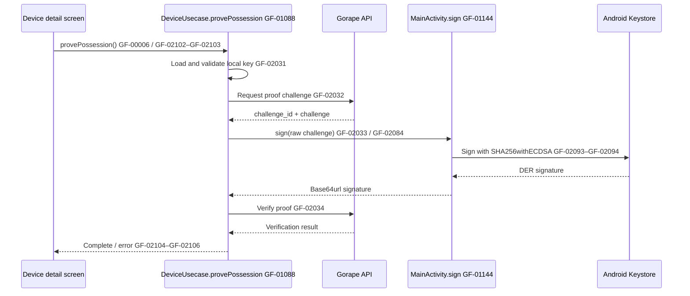
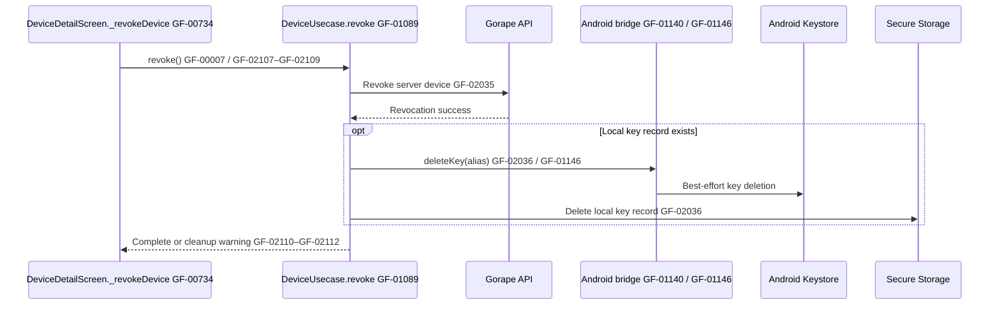
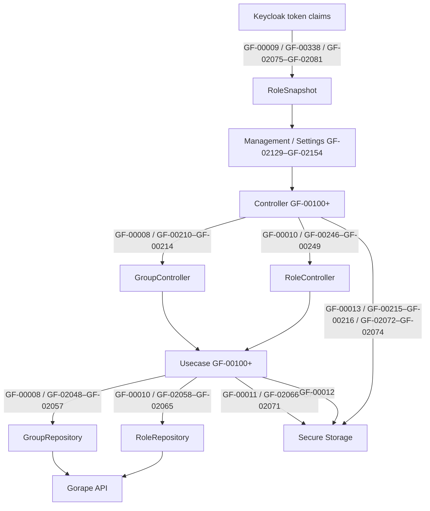

# Architecture and process flows

This guide explains how application processing connects the UI to external
services. IDs in the diagrams match the English source comments.

- [GF-00001](https://github.com/GorapeFlutter/gf-app/blob/main/lib/app.dart#L39)–[GF-00013](https://github.com/GorapeFlutter/gf-app/blob/main/lib/back/controller/language.dart#L12): end-to-end application flows
- [GF-00100](https://github.com/GorapeFlutter/gf-app/blob/main/lib/app.dart#L14)–[GF-01183](https://github.com/GorapeFlutter/gf-app/blob/main/lib/back/repository/device_key.dart#L292): handwritten Dart and native platform functions/callbacks
- [GF-02000](https://github.com/GorapeFlutter/gf-app/blob/main/lib/back/usecase/auth.dart#L53)–[GF-02185](https://github.com/GorapeFlutter/gf-app/blob/main/linux/runner/linux_native_keys.cc#L466): logical steps inside multi-stage and native functions
- [GF-10001](https://github.com/Gorapeflutter/gorape/blob/main/pkg/server/base.go#L13)–[GF-10036](https://github.com/Gorapeflutter/gorape/blob/main/pkg/server/usecase/passkey_device.go#L483): Gorape backend handlers, usecases, WebAuthn RP, MDS, revocation, authentication assurance, and external service proof verification APIs
- Tests and generated code are not included.

See the [function ID index](FUNCTION_INDEX.md) and
[processing-step ID index](PROCESS_INDEX.md) for the complete lists.

## Layers



Function IDs span [GF-00100](https://github.com/GorapeFlutter/gf-app/blob/main/lib/app.dart#L14)–[GF-01183](https://github.com/GorapeFlutter/gf-app/blob/main/lib/back/repository/device_key.dart#L292); function-step IDs span
[GF-02000](https://github.com/GorapeFlutter/gf-app/blob/main/lib/back/usecase/auth.dart#L53)–[GF-02185](https://github.com/GorapeFlutter/gf-app/blob/main/linux/runner/linux_native_keys.cc#L466). The indexes map IDs to symbols and source files.

- **UI** renders screens and gathers user input. It starts application work through a Controller.
- **Controller** owns Riverpod state, calls Usecases, and invalidates dependent providers after updates.
- **Usecase** composes application workflows, including operations that coordinate multiple repositories.
- **Repository** forms the boundary to HTTP, OIDC, secure storage, and native APIs.
- Non-Android native providers currently report local key protection separately from remote attestation; Gorape only accepts same-key Android evidence for enrollment.
- **Entity** defines the data passed between layers.
- **UI text** is referenced by `MCODE-XXXXX` IDs. Japanese/English entries live in `lib/config/langages/messages.dart`; `AppText` resolves each code using the selected locale.

## System architecture and trust boundaries

The same sign-in session and device-trust flow involve different protocol
roles. Keycloak is the OIDC Identity Provider (IdP), and it is also the WebAuthn
Relying Party (RP) for Keycloak credentials. `gf-app` is the public OIDC client.
Gorape is also a separate WebAuthn RP for device passkeys: the app performs a
second registration ceremony and sends the complete `attestationObject` to
Gorape. A Keycloak credential cannot be reused because credentials are scoped
to their RP ID. The older Android Keystore registration endpoints remain for
compatibility but are no longer used by the device-registration screen.

```mermaid
flowchart LR
    User[User]
    LocalUV[Local user verification<br/>biometric / PIN]
    Authenticator[Authenticator<br/>platform authenticator / passkey provider]
    Keycloak[Keycloak<br/>OIDC IdP; WebAuthn RP for Keycloak passkeys]
    App[gf-app<br/>public OIDC client]
    API[Gorape API<br/>OAuth resource server / device-trust RP]
    PasskeyPlugin[passkeys Flutter plugin]
    WebAuthnRP[Gorape WebAuthn RP and verifier policy]
    Native[Android MainActivity<br/>MethodChannel GF-01140]
    Keystore[Android Keystore]

    User -->|Sign-in GF-00002 / GF-00136| App
    App -->|Authorization Code + PKCE GF-00002 / GF-01056| Keycloak
    Keycloak -->|Optional WebAuthn challenge| Authenticator
    User -->|Local UV, when requested by passkey| LocalUV
    LocalUV --> Authenticator
    Authenticator -->|Signed assertion| Keycloak
    Keycloak -->|OIDC code / tokens| App
    App -->|Bearer access token GF-00003 / GF-00551| API

    App -->|Registration challenge GF-00005 / GF-02026| API
    API -->|challenge_id + challenge| App
    App -->|Register GF-00005 / GF-01087| Native
    Native -->|Generate key GF-01142 / GF-01143| Keystore
    Keystore -->|Public key + Android certificate chain GF-02090| Native
    Native -->|Registration evidence| App
    App -->|Registration verify GF-02028| API

    API -->|Possession challenge GF-00006 / GF-02032| App
    App -->|Sign challenge GF-00006 / GF-01088 / GF-01144| Native
    Native -->|Private-key operation; key remains local| Keystore
    Keystore -->|DER signature| Native
    Native -->|Signature| App
    App -->|Proof verify GF-02034| API

    App -->|Registration options| API
    API -->|RP ID + challenge + attestation preference| App
    App -->|WebAuthn create()| PasskeyPlugin
    PasskeyPlugin --> Authenticator
    Authenticator -->|Credential + attestationObject| PasskeyPlugin
    PasskeyPlugin --> App
    App -->|Complete credential response| API
    API --> WebAuthnRP
```

**Local user verification boundary:** Keycloak and Gorape passkeys each perform
their own user-verification ceremony in the authenticator/platform. The app
receives only WebAuthn responses and never biometric data. Gorape requests
`userVerification: required` by default. The separate, legacy Android
device-registration key sets
`setUserAuthenticationRequired(false)` in [GF-01143](https://github.com/GorapeFlutter/gf-app/blob/main/android/app/src/main/kotlin/com/gorapeflutter/gf_app/MainActivity.kt#L176), so that device-key
registration/proof path does not require local UV. Do not interpret the passkey
UV step as a property of the current [GF-00005](https://github.com/GorapeFlutter/gf-app/blob/main/lib/back/usecase/device.dart#L89) key.

| Term | Role in this architecture |
| --- | --- |
| Authenticator | Creates/uses a passkey or, on the legacy path, performs Android Keystore operations. |
| Local user verification (UV) | Authenticator/platform check, such as biometric or PIN, independently requested by each RP. |
| Keycloak IdP | Authenticates the user and issues OIDC tokens; it is the RP for Keycloak credentials. |
| `gf-app` | Public OIDC client; coordinates the Gorape WebAuthn ceremony and forwards the credential response. |
| Gorape API | OAuth resource server and WebAuthn RP; verifies RP ID, origin, challenge, credential, attestation policy, and possession assertions. |

### Gorape backend request path



The backend ID range is [GF-10001](https://github.com/Gorapeflutter/gorape/blob/main/pkg/server/base.go#L13) through [GF-10036](https://github.com/Gorapeflutter/gorape/blob/main/pkg/server/usecase/passkey_device.go#L483). It is maintained in the
Gorape repository and linked separately from gf-app's Dart/Android IDs. See the
[backend source index](https://github.com/Gorapeflutter/gorape/blob/main/docs/book/src/source-index.md).
Platform provisioning uses [GF-10023](https://github.com/Gorapeflutter/gorape/blob/main/pkg/server/usecase/provisioning.go#L33) and [GF-10024](https://github.com/Gorapeflutter/gorape/blob/main/pkg/server/usecase/provisioning.go#L59).

## End-to-end flow IDs

| ID | Flow | Main implementation |
| --- | --- | --- |
| [GF-00001](https://github.com/GorapeFlutter/gf-app/blob/main/lib/app.dart#L39) | Startup, settings load, session restoration, and screen routing | `lib/app.dart`, `lib/back/controller/auth.dart`, `lib/back/usecase/auth.dart` |
| [GF-00002](https://github.com/GorapeFlutter/gf-app/blob/main/lib/back/controller/auth.dart#L97) | Keycloak sign-in/sign-out and local session management | `lib/back/controller/auth.dart`, `lib/back/usecase/auth.dart`, `lib/back/repository/auth.dart` |
| [GF-00003](https://github.com/GorapeFlutter/gf-app/blob/main/lib/back/repository/gorape.dart#L614) | Gorape API requests, Bearer token, one refresh-and-retry after 401 | `lib/back/repository/gorape.dart` |
| [GF-00004](https://github.com/GorapeFlutter/gf-app/blob/main/lib/back/controller/project.dart#L12) | Read projects, devices, groups, and attestation data | `lib/back/controller/project.dart`, `device.dart`, `group.dart`, `attestation.dart` |
| [GF-00005](https://github.com/GorapeFlutter/gf-app/blob/main/lib/back/usecase/device.dart#L89) | Android device registration and Key Attestation verification | `lib/back/usecase/device.dart`, `lib/back/repository/device_key.dart`, `MainActivity.kt` |
| [GF-00006](https://github.com/GorapeFlutter/gf-app/blob/main/lib/back/usecase/device.dart#L193) | Prove device possession using its private key | `lib/back/usecase/device.dart`, `lib/back/repository/device_key.dart`, `MainActivity.kt` |
| [GF-00007](https://github.com/GorapeFlutter/gf-app/blob/main/lib/back/usecase/device.dart#L247) | Revoke a device on the server and clean up local key data | `lib/back/usecase/device.dart` |
| [GF-00008](https://github.com/GorapeFlutter/gf-app/blob/main/lib/back/controller/group.dart#L71) | Create/update/delete groups and assign devices | `lib/back/controller/group.dart`, `lib/back/usecase/group.dart`, `lib/back/repository/group.dart` |
| [GF-00009](https://github.com/GorapeFlutter/gf-app/blob/main/lib/back/controller/role.dart#L11) | Resolve UI roles from Keycloak token claims | `lib/back/controller/role.dart`, `lib/entity/model/role.dart` |
| [GF-00010](https://github.com/GorapeFlutter/gf-app/blob/main/lib/back/controller/role.dart#L118) | Manage Gorape project/group role bindings | `lib/back/controller/role.dart`, `lib/back/usecase/role.dart`, `lib/back/repository/role.dart` |
| [GF-00011](https://github.com/GorapeFlutter/gf-app/blob/main/lib/back/controller/connection.dart#L29) | Read/write connection settings and check Gorape health | `lib/back/controller/connection.dart`, `lib/back/usecase/connection.dart` |
| [GF-00012](https://github.com/GorapeFlutter/gf-app/blob/main/lib/back/controller/policy.dart#L11) | Read/write local-only device policy preferences | `lib/back/controller/policy.dart`, `lib/back/usecase/policy.dart` |
| [GF-00013](https://github.com/GorapeFlutter/gf-app/blob/main/lib/back/controller/language.dart#L12) | Read/write the app display language | `lib/back/controller/language.dart` |

These IDs describe application processing. They do not represent backend API
features or authorization grants.

## Startup and authentication

[GF-00001](https://github.com/GorapeFlutter/gf-app/blob/main/lib/app.dart#L39) loads connection settings and restores credentials from secure
storage. A valid session opens the app shell; otherwise the login screen appears.
An expired session may be refreshed before routing to login. [GF-00002](https://github.com/GorapeFlutter/gf-app/blob/main/lib/back/controller/auth.dart#L97) covers
interactive sign-in and sign-out.



## Authenticated API requests

[GF-00003](https://github.com/GorapeFlutter/gf-app/blob/main/lib/back/repository/gorape.dart#L614) sends only the Keycloak **access token** as the Bearer token. On a
401 response, the client attempts one refresh and, if successful, retries the
original request once. The ID token is never sent to Gorape.



## Android registration, proof, and revocation

Registration binds the raw server challenge to an Android Keystore key. The
private key never leaves the device; the app submits the public key and a
leaf-first certificate chain. If verification fails, the generated key is
deleted on a best-effort basis.



Possession proof ([GF-00006](https://github.com/GorapeFlutter/gf-app/blob/main/lib/back/usecase/device.dart#L193)) obtains a fresh challenge, signs its raw bytes
inside Keystore, and submits the ASN.1/DER signature for server verification.





## Passkey attestation, TPM, and platform coverage

“Passkey attestation” and the Android device-registration flow above are related
but different protocols. A passkey is a WebAuthn/FIDO credential managed by a
browser or credential provider. The app's device-registration screen now uses
the WebAuthn route and sends the complete `attestationObject`. The legacy
Android Keystore flow still creates a separate application device key and is
not itself passkey attestation.

| Flow | Key being attested | Evidence format | What this repository does |
| --- | --- | --- | --- |
| Legacy Android key registration ([GF-00005](https://github.com/GorapeFlutter/gf-app/blob/main/lib/back/usecase/device.dart#L89)) | App-generated EC P-256 device key | Android Keystore X.509 certificate chain; challenge bound with `setAttestationChallenge` | Retained for compatibility; separate from passkeys |
| WebAuthn `fmt: "none"` | Credential-provider passkey | Complete WebAuthn response with no attestation statement | Client forwards it; Gorape rejects by default and permits only with `allow_none: true` |
| WebAuthn `fmt: "tpm"` | Credential key represented by a TPM public area | CBOR statement with TPM structures and AIK certificate chain | Gorape uses go-webauthn v0.14.0 for WebAuthn/TPM statement validation and requires configured `tpm` trust anchors |
| WebAuthn `fmt: "android-key"` | Android WebAuthn credential | WebAuthn Android Key Attestation statement | Gorape validates the statement and configured Android roots; not the legacy PEM route |
| WebAuthn `fmt: "apple"` | Apple platform credential | Apple anonymous attestation statement and certificate chain | Gorape validates the statement and configured `apple` trust anchors |
| Other supported formats (`packed`, `fido-u2f`) | Authenticator credential | Format-specific WebAuthn statement | Accepted only when explicitly allowlisted and its certificate chain is trusted; packed self-attestation also needs explicit opt-in |

The WebAuthn `android-key` format can use Android Key Attestation evidence, but
it wraps that evidence in a WebAuthn `attestationObject` and binds it to the
WebAuthn client/authenticator data. The retained legacy Android path sends its
custom `evidence.certificate_chain` to a different Gorape device-registration
endpoint.

### What the WebAuthn TPM format contains

The [WebAuthn Level 3 Recommendation, §8.3](https://www.w3.org/TR/2026/REC-webauthn-3-20260825/#sctn-tpm-attestation)
defines `fmt: "tpm"` for TPM 2.0. Its `attStmt` includes `ver`, `alg`, `sig`,
`certInfo`, `pubArea`, and an `x5c` chain whose leaf is the TPM Attestation Key
(AIK) certificate. The AIK is distinct from the passkey's credential key: the
AIK signs evidence about the credential key, while the credential key signs
future authentication assertions.

The relevant part of the WebAuthn CBOR object is:

```text
{
  "fmt": "tpm",
  "attStmt": {
    "ver": "2.0",
    "alg": <COSE algorithm>,
    "x5c": [<AIK certificate>, ...certificate chain],
    "sig": <TPMT_SIGNATURE>,
    "certInfo": <TPMS_ATTEST>,
    "pubArea": <TPMT_PUBLIC>
  },
  "authData": <authenticator data>
}
```

At registration, WebAuthn constructs `attToBeSigned` from `authenticatorData`
and the hash of `clientDataJSON`. A conforming verifier must, among other
checks:

1. Verify the AIK signature and the certificate chain against an explicitly
   trusted policy/metadata source.
2. Check `certInfo.magic` and that `certInfo.type` is `TPM_ST_ATTEST_CERTIFY`.
3. Check that `certInfo.extraData` is the algorithm-appropriate hash of
   `attToBeSigned`.
4. Derive the TPM Name from `pubArea`, compare it with the certified name in
   `certInfo`, and ensure the public key in `pubArea` matches the credential
   public key in `authenticatorData`.

The `tpm` format is therefore not just “a public key signed by a TPM”. It is a
protocol-specific binding between the WebAuthn ceremony, the TPM-certified
credential key, and the AIK trust chain. It also does not, by itself, prove every
property of the operating system, boot state, or ongoing device compliance.

### Standards and published implementation guidance

As of **14 November 2026**, the relevant public work has different maturity and
scope:

- **W3C WebAuthn Working Group:** WebAuthn Level 3 is a Recommendation and
  defines the interoperable TPM attestation format. Its
  [attestation-conveyance preference](https://www.w3.org/TR/2026/REC-webauthn-3-20260825/#enum-attestation-convey)
  defaults to `"none"`. Level 3 also
  [allows a non-zero AAGUID without attestation](https://www.w3.org/TR/2026/REC-webauthn-3-20260825/#sctn-attestation-types),
  so an AAGUID alone is not cryptographic proof of authenticator provenance.
- **Google:** Google's [server-side passkey registration guide](https://developers.google.com/identity/passkeys/developer-guides/server-registration)
  uses `attestationType: 'none'` in its general example. This is consistent
  with a privacy- and interoperability-oriented default; it is not a Google
  TPM-attestation specification. Google Android [Key Attestation guidance](https://developer.android.com/privacy-and-security/security-key-attestation)
  describes a separate Android Keystore certificate-chain mechanism, including
  Remote Key Provisioning (RKP), trust roots, and certificate revocation.
- **FIDO Alliance:** The [FIDO Server Requirements v2.3 Review Draft](https://fidoalliance.org/specs/fidoserver/fido-server-v2.3-rd-20260226.html)
  lists TPM attestation support as a server requirement, but explicitly says
  the review draft is not a basis for implementation and may change. The
  [Enterprise Deployment Working Group's attestation white paper](https://fidoalliance.org/fido-attestation-enhancing-trust-privacy-and-interoperability-in-passwordless-authentication/)
  is explanatory guidance, not a normative protocol specification.
- **Trusted Computing Group (TCG):** TPM 2.0 structures used by WebAuthn
  (`TPMS_ATTEST`, `TPMT_PUBLIC`, AIK/Endorsement Key credentials) are defined by
  the TPM specifications. WebAuthn defines how those structures are encoded
  and verified for the `tpm` format.

### Flutter platform behavior and deployment requirements

- Do not describe [GF-00005](https://github.com/GorapeFlutter/gf-app/blob/main/lib/back/usecase/device.dart#L89) as passkey attestation. It proves properties of an
  app-generated Android Keystore key using Android's attestation extension.
- `passkeys` 2.23.2 passes WebAuthn creation/request options and returns the
  credential response on Android, iOS, macOS, Windows, and Web. Linux has no
  plugin implementation and fails closed.
- Android Credential Manager and browser/Windows providers may return `none`
  even when direct conveyance was requested. Apple platform credentials do not
  expose a conveyance preference in the plugin. The returned `fmt`, not the
  requested preference or platform string, is authoritative.
- Android needs Digital Asset Links (`delegate_permission/common.get_login_creds`
  and `delegate_permission/common.handle_all_urls`) for the Gorape RP domain
  and app signing certificates. iOS/macOS need an
  AASA `webcredentials` entry plus matching Associated Domains entitlements. Web
  needs a secure origin and an RP ID that is the page host or its parent.
- Configure `Application.Server.WebAuthn.rp_id` and exact `rp_origins` on the
  server. The app and domain association must use that same RP ID. Native app
  origins (for example Android's `android:apk-key-hash:`) must be listed
  explicitly; never allow wildcard origins.
- Configure the server's `attestation.allowed_formats` and per-format
  `trust_anchors`. The default empty allowlist with `allow_none: false` rejects
  every registration; untrusted chains and unsupported formats always fail.
- Keep policy for `none`, direct attestation, and enterprise attestation
  explicit. Requiring model-identifying attestation can exclude synced passkeys
  and disclose device information. Enterprise attestation can be uniquely
  identifying and should be limited to managed, pre-authorized RPs.
- Windows/Linux/Web use system-browser or browser-redirect OIDC with PKCE.
- Linux passkey ceremonies use the gf-app browser page and a short-lived
  Gorape capability; Gorape does not serve or own the end-user UI.
- For the existing Android Key Attestation flow, keep Google trust roots and
  revocation data current. Google's Android guidance says Android 16 devices
  launched with the platform use RKP rather than factory-provisioned keys; do
  not assume one static root bundle forever.

## Management data and local preferences

- [GF-00004](https://github.com/GorapeFlutter/gf-app/blob/main/lib/back/controller/project.dart#L12): List/detail providers call Usecases through Controllers; repositories fetch data from Gorape. Controllers invalidate dependent providers after updates.
- [GF-00008](https://github.com/GorapeFlutter/gf-app/blob/main/lib/back/controller/group.dart#L71): Group changes and device assignments are persisted by Gorape.
- [GF-00009](https://github.com/GorapeFlutter/gf-app/blob/main/lib/back/controller/role.dart#L11): Roles derived from token claims gate UI visibility only. Gorape remains authoritative for authorization.
- [GF-00010](https://github.com/GorapeFlutter/gf-app/blob/main/lib/back/controller/role.dart#L118): Gorape role bindings are separate data from the client-side claims projection in [GF-00009](https://github.com/GorapeFlutter/gf-app/blob/main/lib/back/controller/role.dart#L11).
- [GF-00011](https://github.com/GorapeFlutter/gf-app/blob/main/lib/back/controller/connection.dart#L29): Connection settings are stored securely; health checks use the configured API URL.
- [GF-00012](https://github.com/GorapeFlutter/gf-app/blob/main/lib/back/controller/policy.dart#L11): Policy preferences are local-only; the current backend has no policy API.
- [GF-00013](https://github.com/GorapeFlutter/gf-app/blob/main/lib/back/controller/language.dart#L12): The selected display language is stored securely and applied through Riverpod state.



## Finding an implementation

Search for IDs in source with `rg "GF-" lib android`. The repository README
also describes the layers.
