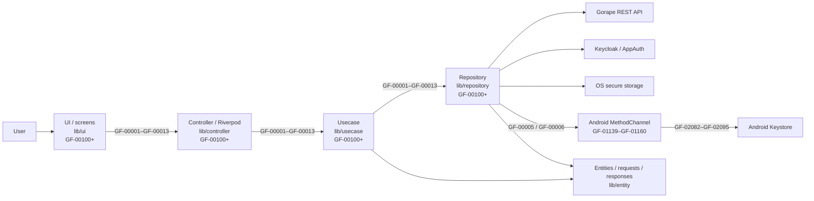
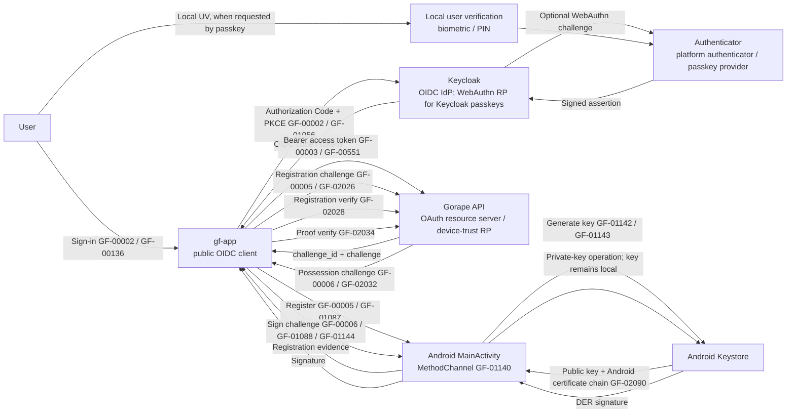
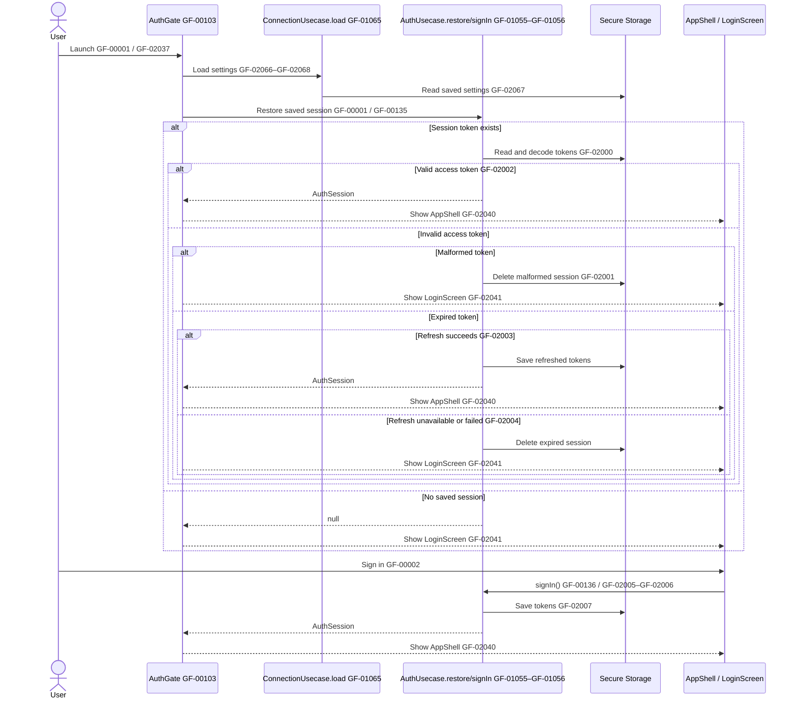
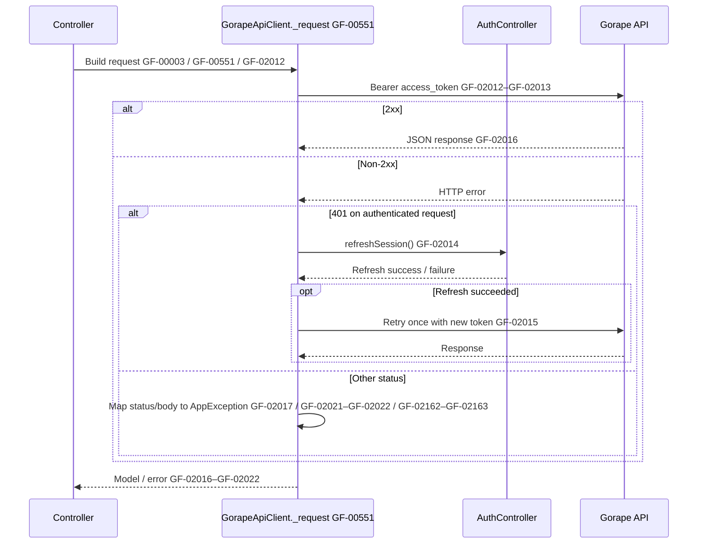
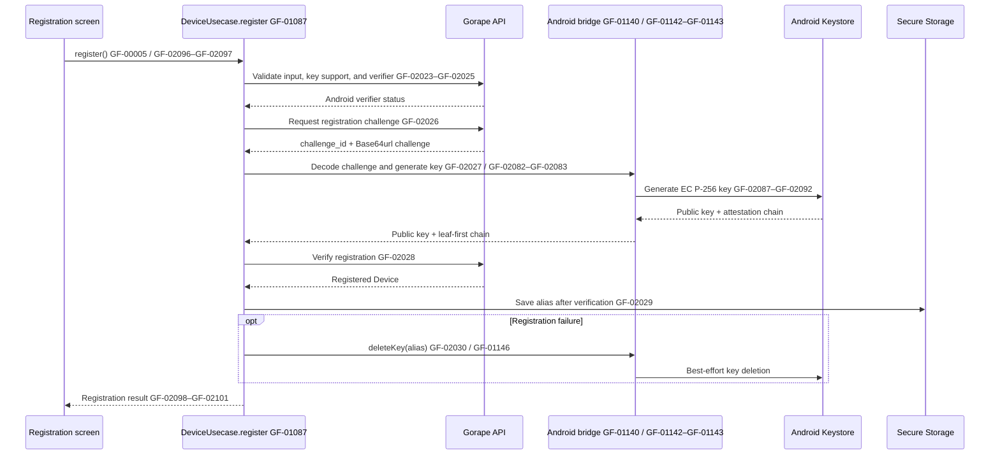
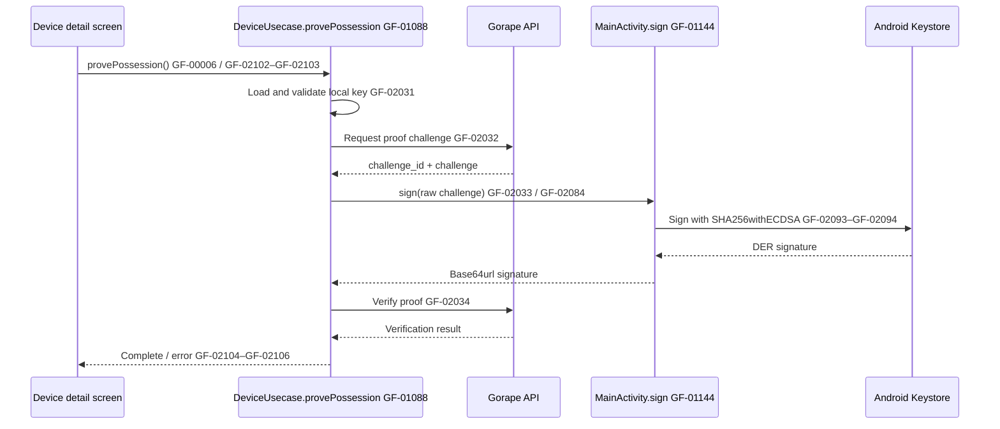
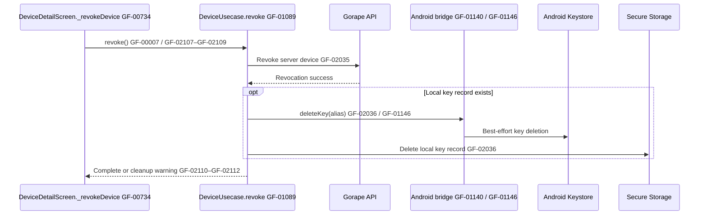
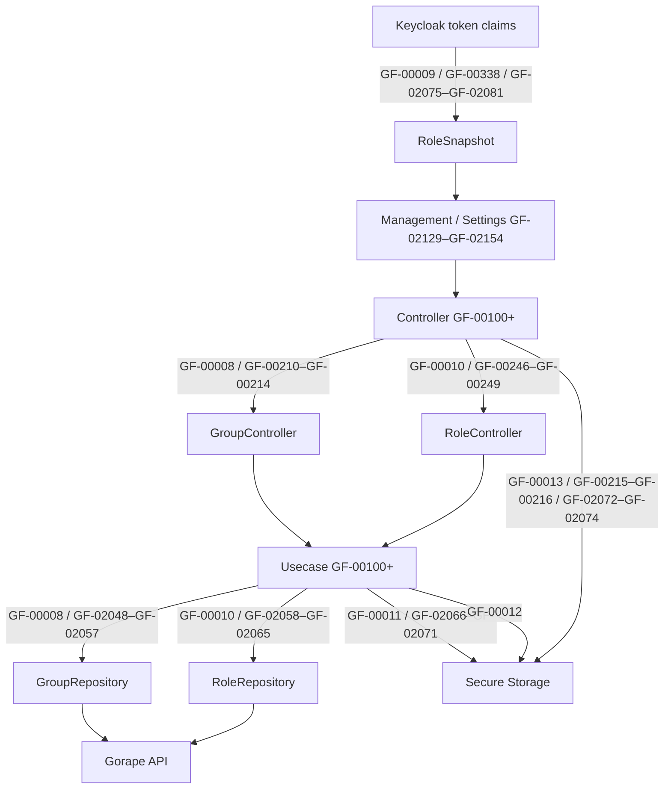

# Architecture and process flows

This guide explains how application processing connects the UI to external
services. IDs in the diagrams match the English source comments.

- [GF-00001](https://github.com/GorapeFlutter/gf-app/blob/main/lib/app.dart#L39)–[GF-00013](https://github.com/GorapeFlutter/gf-app/blob/main/lib/controller/language.dart#L12): end-to-end application flows
- [GF-00100](https://github.com/GorapeFlutter/gf-app/blob/main/lib/app.dart#L14)–[GF-01160](https://github.com/GorapeFlutter/gf-app/blob/main/android/app/src/main/kotlin/com/gorapeflutter/gf_app/MainActivity.kt#L43): handwritten Dart and Android functions/callbacks
- [GF-02000](https://github.com/GorapeFlutter/gf-app/blob/main/lib/usecase/auth.dart#L48)–[GF-02166](https://github.com/GorapeFlutter/gf-app/blob/main/lib/usecase/device.dart#L298): logical steps inside multi-stage functions
- Tests and generated code are not included.

See the [function ID index](FUNCTION_INDEX.md) and
[processing-step ID index](PROCESS_INDEX.md) for the complete lists.

## Layers



Function IDs span [GF-00100](https://github.com/GorapeFlutter/gf-app/blob/main/lib/app.dart#L14)–[GF-01160](https://github.com/GorapeFlutter/gf-app/blob/main/android/app/src/main/kotlin/com/gorapeflutter/gf_app/MainActivity.kt#L43); function-step IDs span
[GF-02000](https://github.com/GorapeFlutter/gf-app/blob/main/lib/usecase/auth.dart#L48)–[GF-02166](https://github.com/GorapeFlutter/gf-app/blob/main/lib/usecase/device.dart#L298). The indexes map IDs to symbols and source files.

- **UI** renders screens and gathers user input. It starts application work through a Controller.
- **Controller** owns Riverpod state, calls Usecases, and invalidates dependent providers after updates.
- **Usecase** composes application workflows, including operations that coordinate multiple repositories.
- **Repository** forms the boundary to HTTP, OIDC, secure storage, and native APIs.
- **Entity** defines the data passed between layers.

## System architecture and trust boundaries

The same sign-in session and the Android device-trust flow involve different
protocol roles. Keycloak is the OIDC Identity Provider (IdP), and it is also the
WebAuthn Relying Party (RP) when passkeys are enabled in Keycloak. `gf-app` is
the public OIDC client. Gorape API is the OAuth resource server and the relying
service for device-registration challenges; it is **not** the passkey/WebAuthn
RP in the current client contract.



**Local user verification boundary:** on the optional Keycloak passkey path, the
authenticator/platform performs the biometric, PIN, or other user-verification
step; `gf-app` receives the OIDC result and does not receive biometric data.
The separate Android device-registration key currently sets
`setUserAuthenticationRequired(false)` in [GF-01143](https://github.com/GorapeFlutter/gf-app/blob/main/android/app/src/main/kotlin/com/gorapeflutter/gf_app/MainActivity.kt#L159), so that device-key
registration/proof path does not require local UV. Do not interpret the passkey
UV step as a property of the current [GF-00005](https://github.com/GorapeFlutter/gf-app/blob/main/lib/usecase/device.dart#L89) key.

| Term | Role in this architecture |
| --- | --- |
| Authenticator | Creates/uses a passkey or performs the Android Keystore operation. |
| Local user verification (UV) | Authenticator/platform check, such as biometric or PIN, on the optional Keycloak passkey path. |
| Keycloak IdP | Authenticates the user and issues OIDC tokens to `gf-app`; it is the WebAuthn RP for passkeys configured there. |
| `gf-app` | Public OIDC client; coordinates device registration/proof through Controller → Usecase → Repository. |
| Gorape API | OAuth resource server and device-trust relying service; it validates access tokens and the registered device key. It has no passkey/WebAuthn endpoint in the current contract. |

## End-to-end flow IDs

| ID | Flow | Main implementation |
| --- | --- | --- |
| [GF-00001](https://github.com/GorapeFlutter/gf-app/blob/main/lib/app.dart#L39) | Startup, settings load, session restoration, and screen routing | `lib/app.dart`, `lib/controller/auth.dart`, `lib/usecase/auth.dart` |
| [GF-00002](https://github.com/GorapeFlutter/gf-app/blob/main/lib/controller/auth.dart#L72) | Keycloak sign-in/sign-out and local session management | `lib/controller/auth.dart`, `lib/usecase/auth.dart`, `lib/repository/auth.dart` |
| [GF-00003](https://github.com/GorapeFlutter/gf-app/blob/main/lib/repository/gorape.dart#L531) | Gorape API requests, Bearer token, one refresh-and-retry after 401 | `lib/repository/gorape.dart` |
| [GF-00004](https://github.com/GorapeFlutter/gf-app/blob/main/lib/controller/project.dart#L12) | Read projects, devices, groups, and attestation data | `lib/controller/project.dart`, `device.dart`, `group.dart`, `attestation.dart` |
| [GF-00005](https://github.com/GorapeFlutter/gf-app/blob/main/lib/usecase/device.dart#L89) | Android device registration and Key Attestation verification | `lib/usecase/device.dart`, `lib/repository/device_key.dart`, `MainActivity.kt` |
| [GF-00006](https://github.com/GorapeFlutter/gf-app/blob/main/lib/usecase/device.dart#L190) | Prove device possession using its private key | `lib/usecase/device.dart`, `lib/repository/device_key.dart`, `MainActivity.kt` |
| [GF-00007](https://github.com/GorapeFlutter/gf-app/blob/main/lib/usecase/device.dart#L244) | Revoke a device on the server and clean up local key data | `lib/usecase/device.dart` |
| [GF-00008](https://github.com/GorapeFlutter/gf-app/blob/main/lib/controller/group.dart#L71) | Create/update/delete groups and assign devices | `lib/controller/group.dart`, `lib/usecase/group.dart`, `lib/repository/group.dart` |
| [GF-00009](https://github.com/GorapeFlutter/gf-app/blob/main/lib/controller/role.dart#L11) | Resolve UI roles from Keycloak token claims | `lib/controller/role.dart`, `lib/entity/model/role.dart` |
| [GF-00010](https://github.com/GorapeFlutter/gf-app/blob/main/lib/controller/role.dart#L118) | Manage Gorape project/group role bindings | `lib/controller/role.dart`, `lib/usecase/role.dart`, `lib/repository/role.dart` |
| [GF-00011](https://github.com/GorapeFlutter/gf-app/blob/main/lib/controller/connection.dart#L29) | Read/write connection settings and check Gorape health | `lib/controller/connection.dart`, `lib/usecase/connection.dart` |
| [GF-00012](https://github.com/GorapeFlutter/gf-app/blob/main/lib/controller/policy.dart#L11) | Read/write local-only device policy preferences | `lib/controller/policy.dart`, `lib/usecase/policy.dart` |
| [GF-00013](https://github.com/GorapeFlutter/gf-app/blob/main/lib/controller/language.dart#L12) | Read/write the app display language | `lib/controller/language.dart` |

These IDs describe application processing. They do not represent backend API
features or authorization grants.

## Startup and authentication

[GF-00001](https://github.com/GorapeFlutter/gf-app/blob/main/lib/app.dart#L39) loads connection settings and restores credentials from secure
storage. A valid session opens the app shell; otherwise the login screen appears.
An expired session may be refreshed before routing to login. [GF-00002](https://github.com/GorapeFlutter/gf-app/blob/main/lib/controller/auth.dart#L72) covers
interactive sign-in and sign-out.



## Authenticated API requests

[GF-00003](https://github.com/GorapeFlutter/gf-app/blob/main/lib/repository/gorape.dart#L531) sends only the Keycloak **access token** as the Bearer token. On a
401 response, the client attempts one refresh and, if successful, retries the
original request once. The ID token is never sent to Gorape.



## Android registration, proof, and revocation

Registration binds the raw server challenge to an Android Keystore key. The
private key never leaves the device; the app submits the public key and a
leaf-first certificate chain. If verification fails, the generated key is
deleted on a best-effort basis.



Possession proof ([GF-00006](https://github.com/GorapeFlutter/gf-app/blob/main/lib/usecase/device.dart#L190)) obtains a fresh challenge, signs its raw bytes
inside Keystore, and submits the ASN.1/DER signature for server verification.





## Passkey attestation, TPM, and this client's scope

“Passkey attestation” and the Android device-registration flow above are related
but different protocols. A passkey is a WebAuthn/FIDO credential managed by a
browser or credential provider. The current `gf-app` Android flow creates a
separate application device key in Android Keystore and sends its certificate
chain to Gorape ([GF-00005](https://github.com/GorapeFlutter/gf-app/blob/main/lib/usecase/device.dart#L89)); it does not register a passkey or send a WebAuthn
`attestationObject`.

| Flow | Key being attested | Evidence format | What this repository does |
| --- | --- | --- | --- |
| Current Android device registration ([GF-00005](https://github.com/GorapeFlutter/gf-app/blob/main/lib/usecase/device.dart#L89)) | App-generated EC P-256 device key | Android Keystore X.509 certificate chain; the Gorape challenge is bound with `setAttestationChallenge` | Implemented for Android; Gorape verifies the Android Key Attestation evidence |
| WebAuthn passkey with `attestation: "none"` | Credential-provider passkey | WebAuthn `attestationObject` with no attestation statement (or an anonymized result) | Not implemented as a passkey-registration flow |
| WebAuthn passkey with `fmt: "tpm"` | Credential key represented by a TPM public area | CBOR WebAuthn attestation statement plus TPM structures and an AIK certificate chain | Not implemented; Gorape has no TPM/WebAuthn attestation endpoint |
| WebAuthn Android Key (`fmt: "android-key"`) | Android WebAuthn credential | WebAuthn Android Key Attestation statement | A separate WebAuthn format; it is not the custom Android flow above |

The WebAuthn `android-key` format can use Android Key Attestation evidence, but
it wraps that evidence in a WebAuthn `attestationObject` and binds it to the
WebAuthn client/authenticator data. `gf-app` instead sends its custom
`evidence.certificate_chain` to Gorape's device-registration endpoint.

### What the WebAuthn TPM format contains

The [WebAuthn Level 3 Recommendation, §8.3](https://www.w3.org/TR/2026/REC-webauthn-3-20260825/#sctn-tpm-attestation)
defines `fmt: "tpm"` for TPM 2.0. Its `attStmt` includes `ver`, `alg`, `sig`,
`certInfo`, `pubArea`, and an `x5c` chain whose leaf is the TPM Attestation Key
(AIK) certificate. The AIK is distinct from the passkey's credential key: the
AIK signs evidence about the credential key, while the credential key signs
future authentication assertions.

The relevant part of the WebAuthn CBOR object is:

```text
{
  "fmt": "tpm",
  "attStmt": {
    "ver": "2.0",
    "alg": <COSE algorithm>,
    "x5c": [<AIK certificate>, ...certificate chain],
    "sig": <TPMT_SIGNATURE>,
    "certInfo": <TPMS_ATTEST>,
    "pubArea": <TPMT_PUBLIC>
  },
  "authData": <authenticator data>
}
```

At registration, WebAuthn constructs `attToBeSigned` from `authenticatorData`
and the hash of `clientDataJSON`. A conforming verifier must, among other
checks:

1. Verify the AIK signature and the certificate chain against an explicitly
   trusted policy/metadata source.
2. Check `certInfo.magic` and that `certInfo.type` is `TPM_ST_ATTEST_CERTIFY`.
3. Check that `certInfo.extraData` is the algorithm-appropriate hash of
   `attToBeSigned`.
4. Derive the TPM Name from `pubArea`, compare it with the certified name in
   `certInfo`, and ensure the public key in `pubArea` matches the credential
   public key in `authenticatorData`.

The `tpm` format is therefore not just “a public key signed by a TPM”. It is a
protocol-specific binding between the WebAuthn ceremony, the TPM-certified
credential key, and the AIK trust chain. It also does not, by itself, prove every
property of the operating system, boot state, or ongoing device compliance.

### Standards and published implementation guidance

As of **14 November 2026**, the relevant public work has different maturity and
scope:

- **W3C WebAuthn Working Group:** WebAuthn Level 3 is a Recommendation and
  defines the interoperable TPM attestation format. Its
  [attestation-conveyance preference](https://www.w3.org/TR/2026/REC-webauthn-3-20260825/#enum-attestation-convey)
  defaults to `"none"`. Level 3 also
  [allows a non-zero AAGUID without attestation](https://www.w3.org/TR/2026/REC-webauthn-3-20260825/#sctn-attestation-types),
  so an AAGUID alone is not cryptographic proof of authenticator provenance.
- **Google:** Google's [server-side passkey registration guide](https://developers.google.com/identity/passkeys/developer-guides/server-registration)
  uses `attestationType: 'none'` in its general example. This is consistent
  with a privacy- and interoperability-oriented default; it is not a Google
  TPM-attestation specification. Google Android [Key Attestation guidance](https://developer.android.com/privacy-and-security/security-key-attestation)
  describes a separate Android Keystore certificate-chain mechanism, including
  Remote Key Provisioning (RKP), trust roots, and certificate revocation.
- **FIDO Alliance:** The [FIDO Server Requirements v2.3 Review Draft](https://fidoalliance.org/specs/fidoserver/fido-server-v2.3-rd-20260226.html)
  lists TPM attestation support as a server requirement, but explicitly says
  the review draft is not a basis for implementation and may change. The
  [Enterprise Deployment Working Group's attestation white paper](https://fidoalliance.org/fido-attestation-enhancing-trust-privacy-and-interoperability-in-passwordless-authentication/)
  is explanatory guidance, not a normative protocol specification.
- **Trusted Computing Group (TCG):** TPM 2.0 structures used by WebAuthn
  (`TPMS_ATTEST`, `TPMT_PUBLIC`, AIK/Endorsement Key credentials) are defined by
  the TPM specifications. WebAuthn defines how those structures are encoded
  and verified for the `tpm` format.

### Implications for `gf-app`

- Do not describe [GF-00005](https://github.com/GorapeFlutter/gf-app/blob/main/lib/usecase/device.dart#L89) as passkey attestation. It proves properties of an
  app-generated Android Keystore key using Android's attestation extension.
- Adding passkeys would require a separate WebAuthn/Credential Manager
  registration flow and an API that accepts and validates the complete
  `attestationObject`; `fmt: "tpm"` must have its own TPM-aware verifier.
- Keep policy for `none`, direct attestation, and enterprise attestation
  explicit. Requiring model-identifying attestation globally can exclude synced
  passkeys and disclose device information. Enterprise attestation can be
  uniquely identifying and should be limited to managed, pre-authorized RPs.
- For the existing Android Key Attestation flow, keep Google trust roots and
  revocation data current. Google's Android guidance says Android 16 devices
  launched with the platform use RKP rather than factory-provisioned keys; do
  not assume one static root bundle forever.

## Management data and local preferences

- [GF-00004](https://github.com/GorapeFlutter/gf-app/blob/main/lib/controller/project.dart#L12): List/detail providers call Usecases through Controllers; repositories fetch data from Gorape. Controllers invalidate dependent providers after updates.
- [GF-00008](https://github.com/GorapeFlutter/gf-app/blob/main/lib/controller/group.dart#L71): Group changes and device assignments are persisted by Gorape.
- [GF-00009](https://github.com/GorapeFlutter/gf-app/blob/main/lib/controller/role.dart#L11): Roles derived from token claims gate UI visibility only. Gorape remains authoritative for authorization.
- [GF-00010](https://github.com/GorapeFlutter/gf-app/blob/main/lib/controller/role.dart#L118): Gorape role bindings are separate data from the client-side claims projection in [GF-00009](https://github.com/GorapeFlutter/gf-app/blob/main/lib/controller/role.dart#L11).
- [GF-00011](https://github.com/GorapeFlutter/gf-app/blob/main/lib/controller/connection.dart#L29): Connection settings are stored securely; health checks use the configured API URL.
- [GF-00012](https://github.com/GorapeFlutter/gf-app/blob/main/lib/controller/policy.dart#L11): Policy preferences are local-only; the current backend has no policy API.
- [GF-00013](https://github.com/GorapeFlutter/gf-app/blob/main/lib/controller/language.dart#L12): The selected display language is stored securely and applied through Riverpod state.



## Finding an implementation

Search for IDs in source with `rg "GF-" lib android`. The repository README
also describes the layers.
