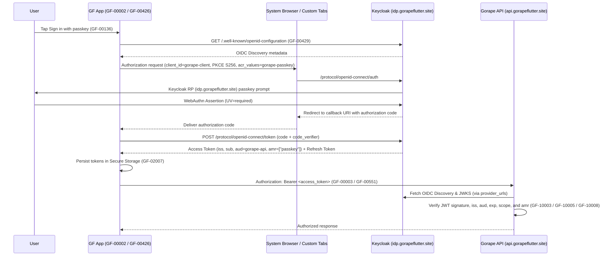
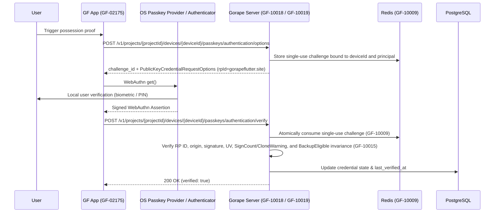
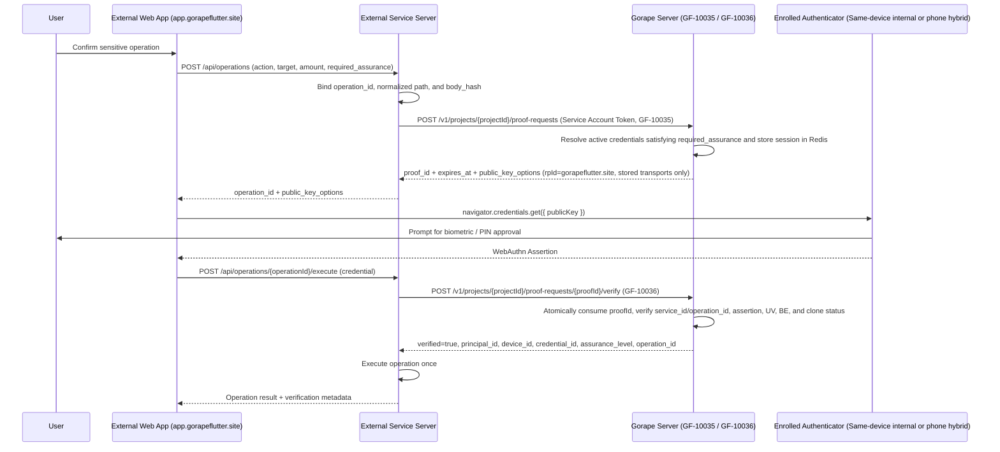

# Gorapeflutter Requirements, Basic Design, and Implementation Specification

This document defines the basic design, domain architecture, network topology, authentication/registration/possession-proof sequences, assurance levels, and platform support matrix for `gf-app` (GF Native), `gorape` (Gorape Server), and the external service samples (`gf-sample-backend` / `gf-sample-web`). Every process is traceable to source code through GF IDs ([GF-00001](https://github.com/GorapeFlutter/gf-app/blob/main/lib/app.dart#L39)–[GF-02186](https://github.com/GorapeFlutter/gf-app/blob/main/lib/back/usecase/connection.dart#L39), [GF-10001](https://github.com/Gorapeflutter/gorape/blob/main/pkg/server/base.go#L13)–[GF-10044](https://github.com/Gorapeflutter/gorape/blob/main/pkg/config/base.go#L277)).

---

## 1. Domain Design (`gorapeflutter.site`)

`gorapeflutter.site` is adopted as the official development and verification domain while preserving full configurability for arbitrary custom domains in production via configuration files, environment variables, `--dart-define`, and the in-app Settings screen ([GF-00114](https://github.com/GorapeFlutter/gf-app/blob/main/lib/config/connection.dart#L16), [GF-00115](https://github.com/GorapeFlutter/gf-app/blob/main/lib/config/connection.dart#L44), [GF-02186](https://github.com/GorapeFlutter/gf-app/blob/main/lib/back/usecase/connection.dart#L39), [GF-10010](https://github.com/Gorapeflutter/gorape/blob/main/pkg/server/repository/webauthn.go#L99), [GF-10011](https://github.com/Gorapeflutter/gorape/blob/main/pkg/server/repository/webauthn.go#L816), [GF-10037](https://github.com/Gorapeflutter/gorape/blob/main/pkg/config/base.go#L194)).

| FQDN | Purpose | Adoption & Design Decision |
|---|---|---|
| `gorapeflutter.site` | Project common domain, WebAuthn RP ID, public association host | **Adopted**: `webauthn.rp_id: gorapeflutter.site`. As the registrable domain (eTLD+1), it is valid for all `*.gorapeflutter.site` subdomain origins under the WebAuthn specification while isolating the Gorape RP trust boundary from Keycloak (`idp.gorapeflutter.site`). Hosts `/.well-known/assetlinks.json` and `/.well-known/apple-app-site-association`. |
| `idp.gorapeflutter.site` | Keycloak / OIDC Provider | **Adopted**: OIDC Issuer (local development default `https://idp.gorapeflutter.site:9443/realms/gorape`, public verification / production example `https://idp.gorapeflutter.site/realms/gorape`). HTTP :8080 is for management/internal access and is not the discovery issuer. |
| `api.gorapeflutter.site` | Gorape API | **Adopted**: Gorape REST API endpoint (local HTTPS default `https://api.gorapeflutter.site:8443`, local HTTP `http://api.gorapeflutter.site:8000`, public/OpenAPI `https://api.gorapeflutter.site`). |
| `app.gorapeflutter.site` | Native app web portal & browser ceremony origin | **Adopted**: Hosts the Linux browser-handoff ceremony page (`https://app.gorapeflutter.site:5174/passkey-ceremony.html`) and Web OIDC callback origin. |
| `rp.gorapeflutter.site` | Candidate WebAuthn RP endpoint | **Not adopted as a separate service (integrated into existing components)**: WebAuthn RP REST endpoints are served by `api.gorapeflutter.site`, and DAL/AASA files must be served directly on the RP ID host (`https://gorapeflutter.site/.well-known/...`). No extra service is introduced; `rp.gorapeflutter.site` can still be added to `rp_origins` via configuration if needed. |

---

## 2. System Architecture Diagram

```mermaid
flowchart LR
    User[User] --> Native[GF Native / gf-app<br/>Android / iOS / macOS / Windows / Linux]
    Native -->|OIDC Authorization Code + PKCE<br/>GF-00002 / GF-00426| Keycloak[Keycloak IdP<br/>idp.gorapeflutter.site]
    Native -->|OS Passkey API / Browser Handoff<br/>GF-02174 / GF-02175| Authn[OS Passkey Provider / Authenticator]
    Native -->|Bearer Access Token + WebAuthn API<br/>GF-00003 / GF-00551| Gorape[Gorape API / WebAuthn RP<br/>api.gorapeflutter.site<br/>RP ID: gorapeflutter.site]
    Gorape --> PG[(PostgreSQL<br/>Persistent Trust Store)]
    Gorape --> Redis[(Redis<br/>One-Time Challenge State)]
    Authn -.->|DAL / AASA Verification| WellKnown[Public Association Endpoints<br/>https://gorapeflutter.site/.well-known/*]

    User --> Vue[External Web App / gf-sample-web<br/>app.gorapeflutter.site]
    Vue -->|OIDC + PKCE| Keycloak
    Vue -->|1. Start Sensitive Operation| Svc[External Service Server / gf-sample-backend]
    Svc -->|2. Service Account + GF-10035<br/>POST /proof-requests| Gorape
    Gorape -->|3. proof_id + public_key_options| Svc
    Svc -->|4. WebAuthn Options| Vue
    Vue -->|5. navigator.credentials.get()<br/>Same-device internal / Cross-device hybrid| Authn
    Authn -->|6. Signed Assertion| Vue
    Vue -->|7. Submit Assertion| Svc
    Svc -->|8. GF-10036<br/>POST /proof-requests/:proofId/verify| Gorape
    Gorape -->|9. verified + assurance_level + operation_id| Svc
    Svc -->|10. Execute Operation Once| Vue
```

---

## 3. Network Configuration Diagram (Local Development vs. Public Verification)

`*.gorapeflutter.site` resolves to `127.0.0.1` via wildcard DNS. Because Android Credential Manager (Google) and Apple Associated Domains (Apple CDN) fetch association files from the public internet at `https://gorapeflutter.site/.well-known/...`, local development and public verification environments are separated as follows:

```mermaid
flowchart TB
    subgraph PublicNet[Public Verification Environment / Internet]
        GoogleDAL[Google DAL Verifier] -->|HTTPS GET| ApexHost[https://gorapeflutter.site<br/>/.well-known/assetlinks.json<br/>/.well-known/apple-app-site-association]
        AppleCDN[Apple AASA CDN] -->|HTTPS GET| ApexHost
        PublicDNS[Authoritative DNS: gorapeflutter.site<br/>*.gorapeflutter.site IN A 127.0.0.1]
    end

    subgraph DevHost[Developer PC / Docker Host (127.0.0.1)]
        KC[Keycloak Container<br/>idp.gorapeflutter.site:8080]
        API[Gorape Server Container<br/>api.gorapeflutter.site:8000 / :8443 TLS]
        Portal[Ceremony Portal / Sample Web<br/>app.gorapeflutter.site:5174]
        PG[(PostgreSQL :5432)]
        RD[(Redis :6379)]
        API --> PG
        API --> RD
        API -->|provider_urls internal rewrite<br/>http://keycloak:8080| KC
    end

    subgraph MobileDev[Android / iOS Physical Devices & Emulators]
        AndroidApp[GF App on Android]
        iOSApp[GF App on iOS]
    end

     AndroidApp -->|adb reverse tcp:8443 / tcp:9443<br/>or LAN DNS| DevHost
    iOSApp -->|LAN DNS resolving to PC LAN IP| DevHost
```

- **Local Development Network Notes**:
  - `127.0.0.1` refers to the connecting device itself. On Android physical devices and emulators, `./scripts/run-android.sh` configures `adb reverse tcp:8443 tcp:8443` and `adb reverse tcp:9443 tcp:9443` to forward HTTPS API/OIDC traffic to the developer PC. The Keycloak HTTP :8080 endpoint advertises the HTTPS :9443 issuer in discovery.
  - For iOS physical devices or Android devices without `adb reverse`, configure a LAN DNS resolver (such as `dnsmasq`) so `idp.gorapeflutter.site` and `api.gorapeflutter.site` resolve to the developer PC's LAN IP, and add that IP to the local TLS certificate SANs with `./scripts/generate-local-tls.sh --host <LAN_IP>`.
  - Disabling TLS certificate verification (`InsecureSkipVerify`, etc.) is strictly prohibited.

---

## 4. Authentication, Registration, and Possession-Proof Sequences

### 4.1 OIDC Authentication Sequence ([GF-00002](https://github.com/GorapeFlutter/gf-app/blob/main/lib/back/controller/auth.dart#L93) / [GF-10003](https://github.com/Gorapeflutter/gorape/blob/main/pkg/server/share/base.go#L15) / [GF-10005](https://github.com/Gorapeflutter/gorape/blob/main/pkg/server/usecase/project.go#L42) / [GF-10006](https://github.com/Gorapeflutter/gorape/blob/main/pkg/server/usecase/project.go#L63))

The client authenticates against Keycloak (`idp.gorapeflutter.site`) using OIDC Authorization Code + PKCE (`S256`) and sends only the **Access Token** to the Gorape API (`api.gorapeflutter.site`). Device registration and possession proofs require `amr: ["passkey"]` in the validated access token ([GF-10008](https://github.com/Gorapeflutter/gorape/blob/main/pkg/server/usecase/device.go#L146)).



### 4.2 Device Registration Sequence ([GF-02174](https://github.com/GorapeFlutter/gf-app/blob/main/lib/back/usecase/passkey_device.dart#L56) / [GF-10012](https://github.com/Gorapeflutter/gorape/blob/main/pkg/server/repository/webauthn.go#L311) / [GF-10013](https://github.com/Gorapeflutter/gorape/blob/main/pkg/server/repository/webauthn.go#L350) / [GF-10016](https://github.com/Gorapeflutter/gorape/blob/main/pkg/server/usecase/passkey_device.go#L92) / [GF-10017](https://github.com/Gorapeflutter/gorape/blob/main/pkg/server/usecase/passkey_device.go#L152))

```mermaid
sequenceDiagram
    participant User
    participant App as GF App (GF-02174)
    participant OS as OS Passkey Provider / Authenticator
    participant DAL as https://gorapeflutter.site/.well-known/*
    participant Server as Gorape Server (GF-10016 / GF-10017)
    participant Redis as Redis (GF-10009)
    participant DB as PostgreSQL

    User->>App: Start device registration
    App->>Server: POST /v1/projects/{projectId}/devices/passkeys/registration/options
    Server->>Server: Verify Bearer Token, passkey AMR, and device:register permission (GF-10008 / GF-10016)
    Server->>Redis: Store single-use challenge & WebAuthn SessionData (TTL 5m)
    Server-->>App: challenge_id + PublicKeyCredentialCreationOptions (rp.id=gorapeflutter.site, UV=required, RK=required)
    App->>OS: WebAuthn create()
    OS->>DAL: Validate RP ID (gorapeflutter.site) app association (DAL / AASA)
    OS->>User: Local user verification (biometric / PIN)
    OS-->>App: PublicKeyCredential + clientDataJSON + attestationObject
    App->>Server: POST /v1/projects/{projectId}/devices/passkeys/registration/verify
    Server->>Redis: Atomically consume single-use challenge (GF-10009)
    Server->>Server: Verify challenge, origin, RP ID (gorapeflutter.site), signature, attestation chain/MDS, BE/BS flags (GF-10011 / GF-10013)
    Server->>Server: Classify assurance_level (hardware_attested / device_bound_unattested / standard_passkey)
    Server->>DB: Transactionally store Device, DeviceKey (public key only; raw attestation stripped), and Attestation record
    Server-->>App: 201 Created (Device + Attestation)
```

### 4.3 Device Authentication (Possession Proof & External Service Approval) Sequences

#### (a) In-App Device Possession Proof ([GF-02175](https://github.com/GorapeFlutter/gf-app/blob/main/lib/back/usecase/passkey_device.dart#L156) / [GF-10014](https://github.com/Gorapeflutter/gorape/blob/main/pkg/server/repository/webauthn.go#L475) / [GF-10015](https://github.com/Gorapeflutter/gorape/blob/main/pkg/server/repository/webauthn.go#L489) / [GF-10018](https://github.com/Gorapeflutter/gorape/blob/main/pkg/server/usecase/passkey_device.go#L313) / [GF-10019](https://github.com/Gorapeflutter/gorape/blob/main/pkg/server/usecase/passkey_device.go#L379))



#### (b) External Service Operation-Bound Verification (Same-Device `internal` & Cross-Device `hybrid`, [GF-10035](https://github.com/Gorapeflutter/gorape/blob/main/pkg/server/usecase/passkey_device.go#L423) / [GF-10036](https://github.com/Gorapeflutter/gorape/blob/main/pkg/server/usecase/passkey_device.go#L497))



---

## 5. API Specification

- OpenAPI `servers` in `gorape/docs/openapi/openapi.yaml`:
  - `https://api.gorapeflutter.site` (Public verification / production endpoint)
  - `https://api.gorapeflutter.site:8443` (Local HTTPS development endpoint)
  - `http://api.gorapeflutter.site:8000` (Local HTTP development endpoint)

### 5.1 GF Native WebAuthn APIs
- `POST /v1/projects/{projectId}/devices/passkeys/registration/options` ([GF-10016](https://github.com/Gorapeflutter/gorape/blob/main/pkg/server/usecase/passkey_device.go#L92))
- `POST /v1/projects/{projectId}/devices/passkeys/registration/verify` ([GF-10017](https://github.com/Gorapeflutter/gorape/blob/main/pkg/server/usecase/passkey_device.go#L152))
- `POST /v1/projects/{projectId}/devices/{deviceId}/passkeys/authentication/options` ([GF-10018](https://github.com/Gorapeflutter/gorape/blob/main/pkg/server/usecase/passkey_device.go#L313))
- `POST /v1/projects/{projectId}/devices/{deviceId}/passkeys/authentication/verify` ([GF-10019](https://github.com/Gorapeflutter/gorape/blob/main/pkg/server/usecase/passkey_device.go#L379))
- `POST /v1/passkeys/browser/options` ([GF-10020](https://github.com/Gorapeflutter/gorape/blob/main/pkg/server/usecase/passkey_device.go#L185))
- `POST /v1/passkeys/browser/registration/verify` ([GF-10021](https://github.com/Gorapeflutter/gorape/blob/main/pkg/server/usecase/passkey_device.go#L173))
- `POST /v1/passkeys/browser/authentication/verify` ([GF-10022](https://github.com/Gorapeflutter/gorape/blob/main/pkg/server/usecase/passkey_device.go#L397))

### 5.2 External Service Verification APIs
- **GF-API-01: Issue Operation-Bound Challenge** `POST /v1/projects/{projectId}/proof-requests` ([GF-10035](https://github.com/Gorapeflutter/gorape/blob/main/pkg/server/usecase/passkey_device.go#L423))
  - Required Permission: `proof:request` (`gorape-service` role)
- **GF-API-02: Verify Operation-Bound Assertion** `POST /v1/projects/{projectId}/proof-requests/{proofId}/verify` ([GF-10036](https://github.com/Gorapeflutter/gorape/blob/main/pkg/server/usecase/passkey_device.go#L497))
  - Required Permission: `proof:verify` (`gorape-service` role)

---

## 6. Assurance Level Matrix

The assurance level is derived only from verified server-side evidence. The
client-supplied platform name is never used. Registration, authentication, and
external proof verification apply the same policy.

| Assurance Level (`assurance_level`) | Condition | High-Assurance Services (`hardware_attested`) | Standard Services (`standard_passkey`) |
|---|---|---|---|
| `hardware_attested` | Verified registration, `BE=0` (single-device bound), and verified hardware evidence: `android-key` TEE/StrongBox key description with locked/verified boot, `apple` anonymous attestation chained to Apple roots, `tpm` AIK chain, `fido-u2f` chain, or an MDS entry whose `keyProtection` contains `hardware`/`tee`/`secure_element`/`smart_card` | **Allowed** | **Allowed** |
| `device_bound_unattested` | Verified registration, `BE=0`, but no verified hardware evidence (`fmt=none`, `packed`, or self attestation) | **Denied** | **Allowed** |
| `standard_passkey` | Verified registration with `BE=1` (synchronizable passkey); always this level even if a hardware statement is also present | **Denied** | **Allowed** |
| `rejected` | Failed verification, unacceptable MDS status, revocation, or clone warning | **Denied** | **Denied** |

`packed` and self attestation do not by themselves prove hardware key
protection. `fido_mds_verified` records metadata verification and does not imply
hardware protection. `BE` is immutable per credential; `BE=0` with `BS=1`, or a
`BE` change after registration, is rejected.

### 6.1 Service assurance policy

```yaml
attestation:
  webauthn:
    assurance:
      required: hardware_attested      # or device_bound_unattested / standard_passkey
      allow_synced_passkeys: false     # must be false for hardware_attested
      hardware_formats: [android-key, apple, tpm, fido-u2f]
```

Gorape validates this configuration at startup: `hardware_attested` requires
`allow_synced_passkeys: false` plus at least one hardware-capable format or FIDO
MDS. External proof requests may raise `required_assurance` but cannot lower the
service policy. `user_verification` is forced to `required`.

### 6.2 MDS and revocation re-evaluation

For MDS-backed credentials, Gorape stores the AAGUID and re-evaluates the
authenticator against the current signed MDS on each assertion. A missing entry
or unacceptable status downgrades the credential to `rejected`. When a leaf
attestation certificate was retained and revocation checking is enabled, the
certificate is re-checked via CRL/OCSP subject to the configured cache TTL. The
re-evaluated level and `last_evaluated_at` are persisted. Network failures and
unknown status fail closed for high-assurance decisions.

### 6.3 Cross-device authentication (CDA)

CDA (`hybrid`) is an authenticator capability, not an RP policy. Gorape records
the transports returned by the authenticator at registration and passes them
back unchanged. If the stored record has no transports, the RP omits the hint.
Gorape does not inject `hybrid` or `internal` into `allowCredentials`: an
authenticator that did not advertise CDA cannot be made CDA-capable by a hint.
Local OS keys generated by gf-app (Apple Secure Enclave, Android Keystore,
Windows CNG/TPM) are never substituted for a FIDO credential assertion.

---

## 7. Platform Support Matrix and Verification Status

| Platform | OIDC Login | Passkey Registration & Auth | Same-Device Auth (`internal`) | Cross-Device Auth (`hybrid`) | WebAuthn RP ID / Origin | Association Config & Verification Status |
|---|---|---|---|---|---|---|
| **Android** | Supported (`flutter_appauth`, `com.gorapeflutter.gfapp:/oauth2redirect`) | Supported (Credential Manager) | Supported (No Bluetooth needed) | Supported (Acts as roaming authenticator) | `gorapeflutter.site` / `android:apk-key-hash:<sha256-base64url>` | Configured in `android/app/src/main/res/values/strings.xml` and `config/well-known/assetlinks.json`. Live Google DAL fetch requires public HTTPS hosting at `https://gorapeflutter.site/.well-known/assetlinks.json` |
| **iOS** | Supported (`flutter_appauth`, `com.gorapeflutter.gfapp:/oauth2redirect`) | Supported (AuthenticationServices) | Supported (No Bluetooth needed) | Supported (Acts as roaming authenticator) | `gorapeflutter.site` / `https://gorapeflutter.site` | Configured in `ios/Runner/Runner.entitlements` (`webcredentials:gorapeflutter.site`) and `config/well-known/apple-app-site-association.example`. Apple Team ID provisioning, AASA CDN fetch, and physical device builds are **unverified** |
| **macOS** | Supported (`flutter_appauth`, `com.gorapeflutter.gfapp:/oauth2redirect`) | Supported (AuthenticationServices) | Supported (Touch ID, no Bluetooth needed) | Supported (Initiates QR / hybrid requests) | `gorapeflutter.site` / `https://gorapeflutter.site` | Configured in `macos/Runner/*.entitlements` (`webcredentials:gorapeflutter.site`). Apple Team ID provisioning, AASA CDN fetch, and physical device builds are **unverified** |
| **Windows** | Supported (System browser + PKCE, `http://127.0.0.1:8401/oauth2redirect`) | Supported (Windows WebAuthn API `webauthn.dll`) | Supported (Windows Hello PIN/biometric, no Bluetooth needed) | Supported (Windows WebAuthn QR / hybrid) | `gorapeflutter.site` / `https://gorapeflutter.site` | Implemented and unit-tested. Local Device keys use the CNG Platform Crypto Provider (TPM-backed when available, `windows/runner/windows_native_keys.cpp`). Physical Windows Hello TPM attestation is **unverified** |
| **Linux** | Supported (System browser + PKCE, `http://127.0.0.1:8401/oauth2redirect`) | Supported (System browser handoff `LinuxBrowserPasskeyRepository`) | Supported (Platform authenticator / USB FIDO2 key, no Bluetooth needed) | Supported (Browser hybrid QR flow) | `gorapeflutter.site` / `https://app.gorapeflutter.site:5174` | Implemented via one-time capabilities ([GF-10020](https://github.com/Gorapeflutter/gorape/blob/main/pkg/server/usecase/passkey_device.go#L185)–[GF-10022](https://github.com/Gorapeflutter/gorape/blob/main/pkg/server/usecase/passkey_device.go#L397)) and `web/passkey-ceremony.html`; unit-tested. Physical Linux desktop runtime is **unverified** |

---

## 8. RP ID Migration and Credential Re-Enrollment Procedure

WebAuthn credentials are cryptographically bound to their RP ID (`authenticatorData.rpIdHash = SHA-256(rpId)`). When migrating from an earlier RP ID (such as `gorapeflutter.github.io` or `localhost`) to `gorapeflutter.site` (or a custom production domain), credentials registered under the old RP ID cannot be used for assertions under the new RP ID.

1. **Update Server Configuration**: Update `webauthn.rp_id`, `rp_origins`, `portal_origin`, `browser_api_origin`, and `web_origins` in `gorape/etc/server.yaml` (or `etc/server.yaml.docker`) ([GF-10010](https://github.com/Gorapeflutter/gorape/blob/main/pkg/server/repository/webauthn.go#L99), [GF-10011](https://github.com/Gorapeflutter/gorape/blob/main/pkg/server/repository/webauthn.go#L816)).
2. **Publish Association Files**: Host `https://<new-rp-id>/.well-known/assetlinks.json` and `https://<new-rp-id>/.well-known/apple-app-site-association` on a publicly reachable HTTPS server.
3. **Update Client Association Config**: Update Android `strings.xml` (`asset_statements`) and iOS/macOS Entitlements (`webcredentials:<new-rp-id>`) and rebuild the app.
4. **Revoke Old Devices and Re-Enroll**:
   - Revoke devices registered under the old RP ID via `DELETE /v1/projects/{projectId}/devices/{deviceId}` ([GF-00007](https://github.com/GorapeFlutter/gf-app/blob/main/lib/back/usecase/device.dart#L247) / [GF-00525](https://github.com/GorapeFlutter/gf-app/blob/main/lib/back/repository/gorape.dart#L268)).
   - Register each device again under the new RP ID via `POST /v1/projects/{projectId}/devices/passkeys/registration/options` and `/verify` ([GF-02174](https://github.com/GorapeFlutter/gf-app/blob/main/lib/back/usecase/passkey_device.dart#L56) / [GF-10016](https://github.com/Gorapeflutter/gorape/blob/main/pkg/server/usecase/passkey_device.go#L92) / [GF-10017](https://github.com/Gorapeflutter/gorape/blob/main/pkg/server/usecase/passkey_device.go#L152)).
   - Existing credentials cannot be migrated; only public-key material is retained server-side, so re-enrollment is mandatory.

### 8.1 Deployment status and unverified items

- `*.gorapeflutter.site` (including `hoge`, `api`, `idp`, `app`, `rp`, `local`)
  resolves to `127.0.0.1` for local development.
- The apex `gorapeflutter.site` currently has **no A/AAAA record** (only NS/SOA).
  Public retrieval of `https://gorapeflutter.site/.well-known/assetlinks.json`
  and `https://gorapeflutter.site/.well-known/apple-app-site-association` by
  Google/Apple CDNs, and public TLS certificate issuance (including DNS-01),
  are therefore **blocked/unverified** until DNS control is available.
- Android release signing keys are not available here; DAL contains debug
  certificate fingerprints only.
- The Apple Team ID in the Xcode project and AASA production publication are
  **unverified**; provisioning profiles must match the shipping identity.
- Physical-device validation of Android Credential Manager `fmt=none`, Apple
  anonymous attestation, Windows TPM attestation, and CDA `hybrid` behavior is
  **unverified** in this environment. TLS certificate verification must never
  be disabled as a workaround.
