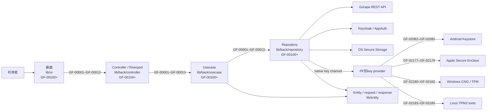
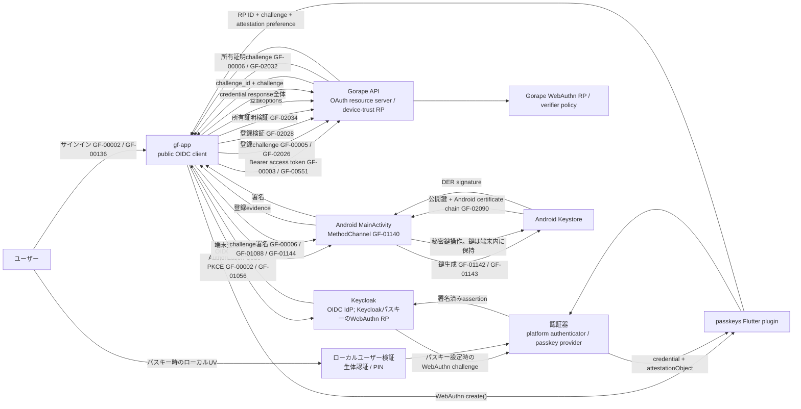
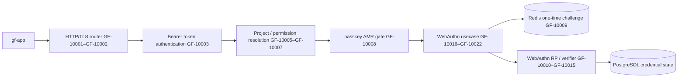
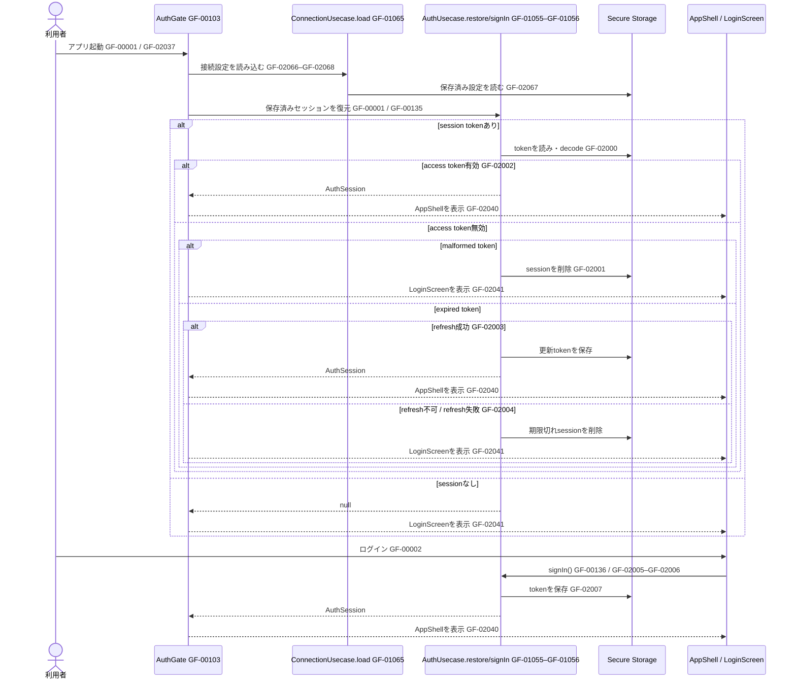
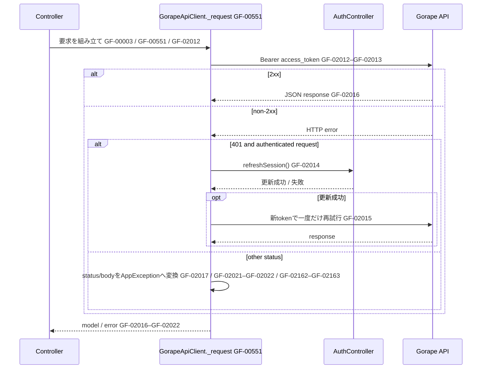
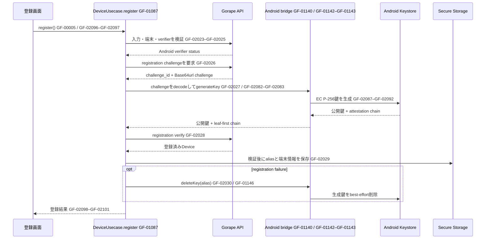
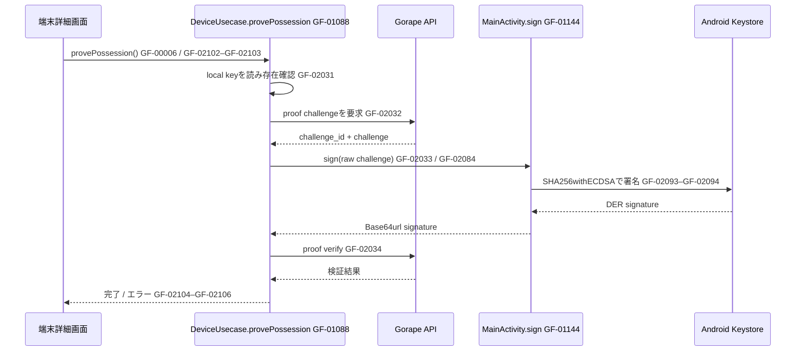
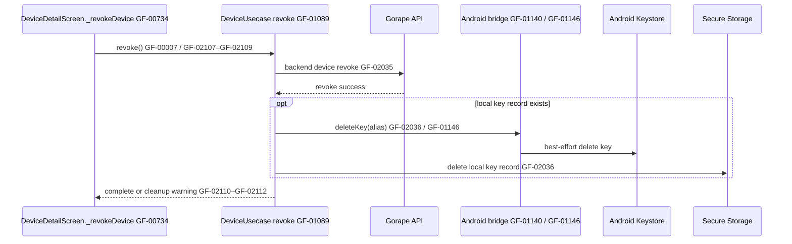
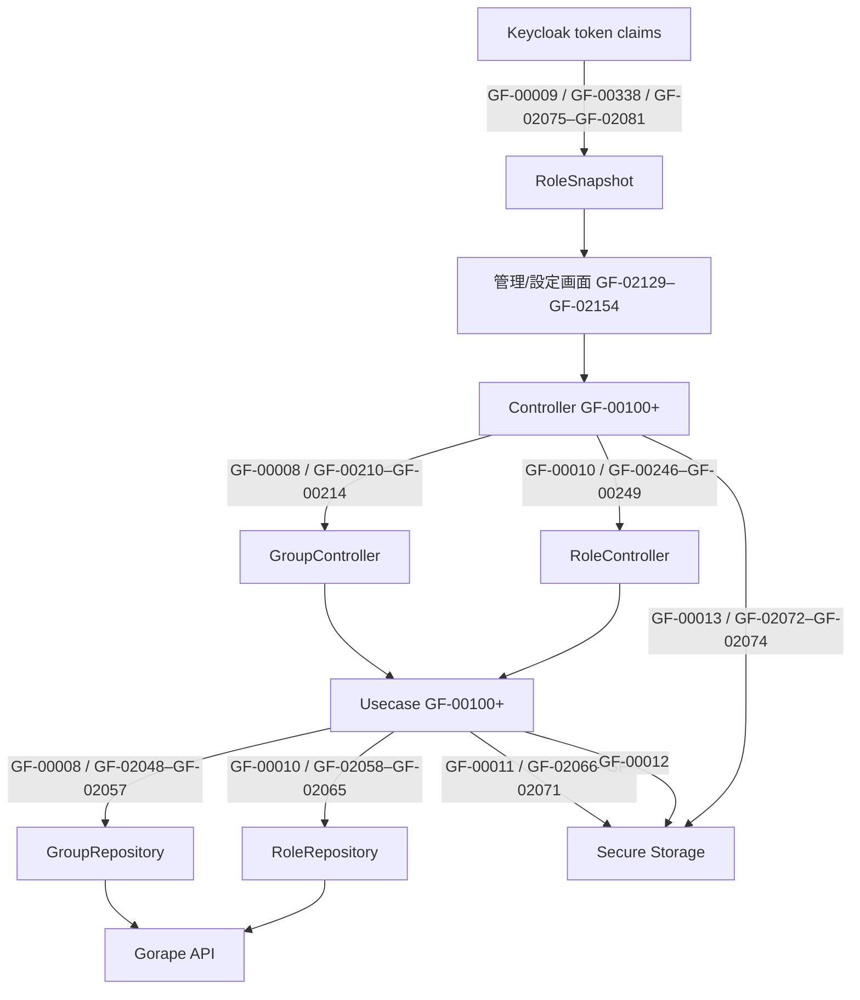

# アーキテクチャと処理フロー

この文書は、アプリ内の処理を `GF-XXXXX` のIDで識別し、UIから外部サービスまでのつながりを説明します。ソースの処理内容は変更せず、ID付きの英語コメントを追加しています。

- [GF-00001](https://github.com/GorapeFlutter/gf-app/blob/main/lib/app.dart#L39)〜[GF-00013](https://github.com/GorapeFlutter/gf-app/blob/main/lib/back/controller/language.dart#L12): エンドツーエンドの処理フロー
- [GF-00100](https://github.com/GorapeFlutter/gf-app/blob/main/lib/app.dart#L14)〜[GF-01184](https://github.com/GorapeFlutter/gf-app/blob/main/lib/entity/model/connection.dart#L60): 手書きのDart関数・メソッド・getter/setter・constructor・callback
- [GF-02000](https://github.com/GorapeFlutter/gf-app/blob/main/lib/back/usecase/auth.dart#L53)〜[GF-02186](https://github.com/GorapeFlutter/gf-app/blob/main/lib/back/usecase/connection.dart#L39): 複数段階の関数内にある論理的な処理ステップ
- [GF-10001](https://github.com/Gorapeflutter/gorape/blob/main/pkg/server/base.go#L13)〜[GF-10037](https://github.com/Gorapeflutter/gorape/blob/main/pkg/config/base.go#L194): Gorape backend handler、usecase、WebAuthn RP、MDS、revocation、authentication assurance、外部サービス検証API
- Kotlinネイティブ関数も関数ID一覧に含みます。テスト・生成コードは対象外です。

関数IDの全件は [`FUNCTION_INDEX.md`](FUNCTION_INDEX.md)、関数内ステップIDは [`PROCESS_INDEX.md`](PROCESS_INDEX.md) を参照してください。

## レイヤー構成



関数IDは全レイヤーで [GF-00100](https://github.com/GorapeFlutter/gf-app/blob/main/lib/app.dart#L14)〜[GF-01184](https://github.com/GorapeFlutter/gf-app/blob/main/lib/entity/model/connection.dart#L60)、関数内ステップIDは [GF-02000](https://github.com/GorapeFlutter/gf-app/blob/main/lib/back/usecase/auth.dart#L53)〜[GF-02186](https://github.com/GorapeFlutter/gf-app/blob/main/lib/back/usecase/connection.dart#L39) です。各IDの関数名と担当ファイルは一覧を参照してください。

- **UI** は表示とユーザー入力を担当します。画面から業務処理を開始するときはControllerを呼び出します。
- **Controller** はRiverpodの状態を管理し、Usecaseを呼び出します。更新後は関連するProviderをinvalidateして再取得します。
- **Usecase** はアプリケーション処理を組み立てます。端末登録のような複数のRepositoryにまたがる処理もここに置きます。
- **Repository** はHTTP、OIDC、Secure Storage、ネイティブ機能との境界です。
- Android以外のnative providerはlocal key protectionとremote Attestationを分離しています。Device登録で同一鍵evidenceを受け入れるserver verifierはAndroidのみです。
- **Entity** はレイヤー間で受け渡すデータを定義します。
- **UI文言**は`MCODE-XXXXX`で参照します。日本語・英語の辞書は`lib/config/langages/messages.dart`に集約し、`AppText`が選択中の言語に応じて表示します。

## システム全体の構成とtrust boundary

サインインとdevice-trust flowでは、同じ認証sessionに見えてもprotocol上の役割が異なります。KeycloakはOIDC Identity Provider（IdP）であり、Keycloak credential用WebAuthn Relying Party（RP）です。`gf-app`はpublic OIDC clientです。Gorapeもdevice passkey用の独立したWebAuthn RPとなり、別の登録ceremonyと完全な`attestationObject`を受け取ります。credentialはRP IDにスコープされるため、Keycloak用credentialをGorapeで再利用できません。従来のAndroid Keystore登録APIは互換性のため残しますが、端末登録画面はWebAuthn経路を利用します。

Androidのdevice-passkey経路はAndroidX Credential Provider APIを使います。`passkeys` pluginが標準Credential Managerのcreate/get requestを送り、Provider選択とユーザー検証UIはAndroid OSが表示します。GF Hardware PasskeysはGorape RP向けのProvider実装であり、標準WebAuthn credential/attestation構造を返します。GF独自部分はAndroid KeystoreでのP-256鍵生成と`android-key` attestation objectの構成です。独自のブラウザwire protocolや選択UIを定義するものではありません。Keycloak RPとそのログインcredentialは別です。現在Providerが返すtransportは`internal`のみで、CDA/hybridは未実装・未検証です。



**ローカルユーザー検証（UV）の境界:** Keycloak用とGorape用のパスキーは、それぞれ独立して認証器/platformにUVを要求します。`gf-app`が受け取るのはWebAuthn responseであり、生体情報は受け取りません。Gorapeの既定は`userVerification: required`です。従来のAndroid device keyは[GF-01143](https://github.com/GorapeFlutter/gf-app/blob/main/android/app/src/main/kotlin/com/gorapeflutter/gf_app/MainActivity.kt#L234)で`setUserAuthenticationRequired(false)`です。

| 用語 | この構成での役割 |
| --- | --- |
| 認証器（Authenticator） | passkeyを作成・利用します。legacy経路ではAndroid Keystore操作も実行します。 |
| ローカルユーザー検証（UV） | 各RPが独立して要求する、生体認証・PIN等の認証器/platform検証です。 |
| Keycloak IdP | ユーザーを認証してOIDC tokenを発行します。Keycloak credentialのWebAuthn RPです。 |
| `gf-app` | Public OIDC clientです。Gorape WebAuthn ceremonyを調整し、credential response全体を転送します。 |
| Gorape API | OAuth resource server兼WebAuthn RPです。RP ID、origin、challenge、credential、attestation policy、所有assertionを検証します。 |

### Gorape backendのrequest path



Backend IDは[GF-10001](https://github.com/Gorapeflutter/gorape/blob/main/pkg/server/base.go#L13)〜[GF-10037](https://github.com/Gorapeflutter/gorape/blob/main/pkg/config/base.go#L194)で、gf-appのDart/Android IDとは別rangeです。実装へのGitHub linkはこのアーキテクチャ図とendpoint tableから参照できます。
全backend IDの一覧は[Gorapeのsource index](https://github.com/Gorapeflutter/gorape/blob/main/docs/book/src/source-index.md)にあります。

## 処理ID一覧

| ID | 処理 | 主な実装 |
| --- | --- | --- |
| [GF-00001](https://github.com/GorapeFlutter/gf-app/blob/main/lib/app.dart#L39) | 起動、接続設定の読み込み、保存済みセッションの復元、画面分岐 | `lib/app.dart`, `lib/back/controller/auth.dart`, `lib/back/usecase/auth.dart` |
| [GF-00002](https://github.com/GorapeFlutter/gf-app/blob/main/lib/back/controller/auth.dart#L93) | Keycloakへのサインイン/サインアウトとローカルセッション管理 | `lib/back/controller/auth.dart`, `lib/back/usecase/auth.dart`, `lib/back/repository/auth.dart` |
| [GF-00003](https://github.com/GorapeFlutter/gf-app/blob/main/lib/back/repository/gorape.dart#L614) | Gorape API呼び出し、Bearer token付与、401時の一度だけの更新・再試行 | `lib/back/repository/gorape.dart` |
| [GF-00004](https://github.com/GorapeFlutter/gf-app/blob/main/lib/back/controller/project.dart#L12) | プロジェクト、端末、グループ、Attestationデータの読み込み | `lib/back/controller/project.dart`, `lib/back/controller/device.dart`, `lib/back/controller/group.dart`, `lib/back/controller/attestation.dart` |
| [GF-00005](https://github.com/GorapeFlutter/gf-app/blob/main/lib/back/usecase/device.dart#L89) | Android端末登録とKey Attestation検証 | `lib/back/usecase/device.dart`, `lib/back/repository/device_key.dart`, `android/app/src/main/kotlin/com/gorapeflutter/gf_app/MainActivity.kt` |
| [GF-00006](https://github.com/GorapeFlutter/gf-app/blob/main/lib/back/usecase/device.dart#L193) | 登録済み端末の秘密鍵による所有証明 | `lib/back/usecase/device.dart`, `lib/back/repository/device_key.dart`, `MainActivity.kt` |
| [GF-00007](https://github.com/GorapeFlutter/gf-app/blob/main/lib/back/usecase/device.dart#L247) | 端末のサーバー側失効とローカル鍵情報の後片付け | `lib/back/usecase/device.dart` |
| [GF-00008](https://github.com/GorapeFlutter/gf-app/blob/main/lib/back/controller/group.dart#L71) | グループの作成/更新/削除と端末の割り当て | `lib/back/controller/group.dart`, `lib/back/usecase/group.dart`, `lib/back/repository/group.dart` |
| [GF-00009](https://github.com/GorapeFlutter/gf-app/blob/main/lib/back/controller/role.dart#L11) | Keycloak token claimsからのUI向けロール解決 | `lib/back/controller/role.dart`, `lib/entity/model/role.dart` |
| [GF-00010](https://github.com/GorapeFlutter/gf-app/blob/main/lib/back/controller/role.dart#L118) | Gorapeのプロジェクト/グループrole bindingの管理 | `lib/back/controller/role.dart`, `lib/back/usecase/role.dart`, `lib/back/repository/role.dart` |
| [GF-00011](https://github.com/GorapeFlutter/gf-app/blob/main/lib/back/controller/connection.dart#L29) | 接続設定の読み書きとGorape health check | `lib/back/controller/connection.dart`, `lib/back/usecase/connection.dart` |
| [GF-00012](https://github.com/GorapeFlutter/gf-app/blob/main/lib/back/controller/policy.dart#L11) | サーバーへ送信しない端末ポリシー設定の読み書き | `lib/back/controller/policy.dart`, `lib/back/usecase/policy.dart` |
| [GF-00013](https://github.com/GorapeFlutter/gf-app/blob/main/lib/back/controller/language.dart#L12) | アプリ表示言語の読み書き | `lib/back/controller/language.dart` |

IDは処理を説明するための参照番号です。バックエンドAPIの機能や権限を表すものではありません。

## 起動と認証

[GF-00001](https://github.com/GorapeFlutter/gf-app/blob/main/lib/app.dart#L39) は接続設定を読み込んだ後、Secure Storageの認証情報を復元します。復元できた場合はアプリ本体へ、できなければログイン画面へ進みます。期限切れでもrefresh tokenが利用可能なら、ログイン画面を表示する前に更新を試みます。



[GF-00003](https://github.com/GorapeFlutter/gf-app/blob/main/lib/back/repository/gorape.dart#L614) のAPI要求はKeycloakの**access token**だけをBearer tokenとして使います。401を受けた場合はセッション更新を一度だけ試し、成功した場合に元の要求を一度だけ再試行します。ID tokenはGorape APIに送信しません。



## Android端末登録と所有証明

登録では、サーバーが発行したchallengeの生バイト列をAndroid Keystoreの鍵生成に結び付けます。秘密鍵は端末外に出さず、公開鍵とleaf-firstの証明書チェーンをサーバーに提出します。登録検証に失敗した場合は、生成した鍵を可能な範囲で削除します。



所有証明（[GF-00006](https://github.com/GorapeFlutter/gf-app/blob/main/lib/back/usecase/device.dart#L193)）では、新しいchallengeを取得し、ローカルKeystoreの秘密鍵で生バイト列に署名します。署名はASN.1/DER形式を維持してサーバーで検証します。失効（[GF-00007](https://github.com/GorapeFlutter/gf-app/blob/main/lib/back/usecase/device.dart#L247)）はサーバー側の成功後にKeystore鍵とSecure Storage上の記録を削除します。





## パスキーattestation、TPM、platform対応範囲

「パスキーattestation」と従来のAndroid端末登録フローは別protocolです。パスキーはbrowserやcredential providerが管理するWebAuthn/FIDO credentialです。端末登録画面はWebAuthn経路を使い、完全な`attestationObject`をGorapeへ送信します。従来のAndroid Keystore flowは互換性のため残りますが、passkey attestationではありません。

| フロー | attestation対象の鍵 | evidence形式 | このrepositoryの対応 |
| --- | --- | --- | --- |
| 旧Android鍵登録（[GF-00005](https://github.com/GorapeFlutter/gf-app/blob/main/lib/back/usecase/device.dart#L89)） | アプリが生成するEC P-256 device key | Android KeystoreのX.509 chain。challengeを`setAttestationChallenge`にbind | 互換性のため維持。passkey attestationとは別 |
| WebAuthn `fmt: "none"` | credential providerのpasskey | statementなしのWebAuthn response | appは転送する。Gorapeは既定で拒否、`allow_none: true`時のみ許可 |
| WebAuthn `fmt: "tpm"` | TPM public areaのcredential key | TPM structure、AIK chainを含むCBOR statement | Gorapeはgo-webauthn v0.14.0でformatを検証し、設定済み`tpm` trust anchorを要求 |
| WebAuthn Android Key（`fmt: "android-key"`） | Android WebAuthn credential | WebAuthn Android Key Attestation statement | GorapeがstatementとAndroid trust anchorを検証。旧PEM経路とは別 |
| WebAuthn Apple（`fmt: "apple"`） | Apple platform credential | Apple anonymous attestation statementと証明書chain | Gorapeがstatementと`apple` trust anchorを検証 |
| その他の対応format（`packed`, `fido-u2f`） | authenticator credential | format固有のWebAuthn statement | allowlistとtrust anchorの両方が必要。packed self-attestationは別途opt-in |

WebAuthnの`android-key` formatもAndroid Key Attestationを利用できますが、evidenceをWebAuthn `attestationObject`に格納し、WebAuthnのclient/authenticator dataへ結び付けます。従来のAndroid経路は独自の`evidence.certificate_chain`を別のGorape endpointへ送信します。

### WebAuthn TPM formatの内容

[WebAuthn Level 3 Recommendation §8.3](https://www.w3.org/TR/2026/REC-webauthn-3-20260825/#sctn-tpm-attestation)は、TPM 2.0用の`fmt: "tpm"`を定義します。`attStmt`には`ver`、`alg`、`sig`、`certInfo`、`pubArea`と、leafがTPM Attestation Key（AIK）certificateとなる`x5c` chainが含まれます。AIKはパスキーのcredential keyとは別の鍵です。AIKがcredential keyについてのevidenceに署名し、credential keyは後続の認証assertionに署名します。

WebAuthn CBOR objectの該当部分は次の形です。

```text
{
  "fmt": "tpm",
  "attStmt": {
    "ver": "2.0",
    "alg": <COSE algorithm>,
    "x5c": [<AIK certificate>, ...certificate chain],
    "sig": <TPMT_SIGNATURE>,
    "certInfo": <TPMS_ATTEST>,
    "pubArea": <TPMT_PUBLIC>
  },
  "authData": <authenticator data>
}
```

登録時、WebAuthnは`authenticatorData`と`clientDataJSON`のhashから`attToBeSigned`を構成します。準拠するverifierは少なくとも次を検証します。

1. AIK signatureとcertificate chainを、明示したtrust policy/metadata sourceに対して検証する。
2. `certInfo.magic`および`certInfo.type`が`TPM_ST_ATTEST_CERTIFY`であることを確認する。
3. `certInfo.extraData`が`attToBeSigned`のhashと一致することを確認する。
4. `pubArea`からTPM Nameを計算して`certInfo`内のcertified nameと照合し、`pubArea`の公開鍵が`authenticatorData`のcredential public keyと一致することを確認する。

したがってTPM formatは、単に「公開鍵をTPMで署名する」ものではありません。WebAuthn ceremony、TPMがcertifyしたcredential key、AIK trust chainの間を結び付けるprotocolです。また、それだけでOS、boot state、継続的な端末complianceの全てが証明されるわけではありません。

### 標準化団体・公開実装資料の状況

**2026年11月14日時点**で、関連する公開資料の成熟度と範囲はそれぞれ異なります。

- **W3C WebAuthn Working Group:** WebAuthn Level 3はRecommendationであり、相互運用可能なTPM attestation formatを定義しています。[attestation conveyance preference](https://www.w3.org/TR/2026/REC-webauthn-3-20260825/#enum-attestation-convey)の既定値は`"none"`です。またLevel 3では[attestationなしでもnon-zero AAGUIDを返せる](https://www.w3.org/TR/2026/REC-webauthn-3-20260825/#sctn-attestation-types)ため、AAGUIDだけではauthenticator provenanceの暗号学的証明になりません。
- **Google:** Googleの[server-side passkey registration guide](https://developers.google.com/identity/passkeys/developer-guides/server-registration)は、一般例で`attestationType: 'none'`を指定しています。これはprivacyと相互運用性を重視する既定方針と整合しますが、Google独自のTPM attestation仕様を意味しません。GoogleのAndroid [Key Attestation資料](https://developer.android.com/privacy-and-security/security-key-attestation)は、Remote Key Provisioning（RKP）、trust root、certificate revocationを含む別のAndroid Keystore certificate-chain方式を説明しています。
- **FIDO Alliance:** [FIDO Server Requirements v2.3 Review Draft](https://fidoalliance.org/specs/fidoserver/fido-server-v2.3-rd-20260226.html)はserver側のTPM attestation対応を要件として記載しますが、review draft自身が実装の根拠として使わないよう明記し、仕様変更の可能性を示しています。[Enterprise Deployment Working Groupのattestation白書](https://fidoalliance.org/fido-attestation-enhancing-trust-privacy-and-interoperability-in-passwordless-authentication/)は説明資料であり、normative protocol仕様ではありません。
- **Trusted Computing Group（TCG）:** WebAuthnが利用するTPM 2.0 structure（`TPMS_ATTEST`、`TPMT_PUBLIC`、AIK/Endorsement Key credential）を定義します。WebAuthnはそれらを`tpm` formatでどうencode・検証するかを定義します。

### Flutter pluginとdeploy要件

- [GF-00005](https://github.com/GorapeFlutter/gf-app/blob/main/lib/back/usecase/device.dart#L89)をパスキーattestationと呼ばないでください。これはAndroid Key Attestation extensionを使い、アプリが生成したAndroid Keystore keyのpropertiesを検証します。
- `passkeys` 2.23.2はAndroid/iOS/macOS/Windows/Webでresponse全体を返します。Linuxはgf-appのWeb ceremony pageをChrome/Firefoxで使います。Gorape本体は画面を持ちません。
- Android Credential ManagerやWindows/browser providerは`direct`を要求しても`none`を返し得ます。Apple platform credentialではpluginがattestation preferenceを指定できません。要求値やplatform文字列ではなく、実際の`fmt`を検証します。
- Android RP domainには`delegate_permission/common.get_login_creds`と`delegate_permission/common.handle_all_urls`を含むDigital Asset Links、およびアプリ署名証明書が必要です。iOS/macOSにはAASA `webcredentials` entryとAssociated Domains entitlementが必要です。Webではsecure originを使い、RP IDをpage hostまたはそのparent domainにします。
- `Application.Server.WebAuthn.rp_id`と正確な`rp_origins`をbackendに設定し、appとdomain associationを同じRP IDに合わせます。Androidの`android:apk-key-hash:`等のnative originもallowlistへ明示し、wildcard originは禁止します。
- `Application.Server.Attestation.WebAuthn.allowed_formats`とformat別`trust_anchors`を設定します。既定は空allowlist、`allow_none: false`で全登録を拒否し、信頼されないchainや未対応formatも拒否します。
- `none`、direct、enterprise attestation policyを分離します。model識別可能なattestationの全体必須化は同期passkeyを排除したり端末情報を漏らしたりします。Enterprise attestationは管理対象RPに限定してください。
- Windows/Linux/Webはsystem browserまたはbrowser redirectのOIDC + PKCEを使います。
- Linuxのpasskey ceremony pageはgf-app web targetが提供します。Gorapeは短期capability APIのみで、end-user UIを持ちません。
- 既存のAndroid Key Attestationフローでは、Google trust rootとrevocation情報を継続的に更新してください。GoogleのAndroid資料によると、Android 16で発売される端末はfactory-provisioned keyではなくRKPを使います。trust root bundleが将来も固定だとは想定しないでください。

## 管理データとローカル設定

- [GF-00004](https://github.com/GorapeFlutter/gf-app/blob/main/lib/back/controller/project.dart#L12): 各一覧/詳細ProviderがControllerを通じてUsecaseを呼び出し、RepositoryからGorape APIのデータを取得します。画面操作でデータを変更した後は、Controllerが関連Providerをinvalidateします。
- [GF-00008](https://github.com/GorapeFlutter/gf-app/blob/main/lib/back/controller/group.dart#L71): グループ管理と端末割り当てはGorape APIへ反映されます。
- [GF-00009](https://github.com/GorapeFlutter/gf-app/blob/main/lib/back/controller/role.dart#L11): token claimsから解決したroleは表示や操作ボタンの制御に使われます。最終的な認可はGorapeバックエンドが行います。
- [GF-00010](https://github.com/GorapeFlutter/gf-app/blob/main/lib/back/controller/role.dart#L118): Gorapeに保存されたrole bindingの一覧/変更を扱います。[GF-00009](https://github.com/GorapeFlutter/gf-app/blob/main/lib/back/controller/role.dart#L11)のUI向けclaimsとは別のデータです。
- [GF-00011](https://github.com/GorapeFlutter/gf-app/blob/main/lib/back/controller/connection.dart#L29): 接続設定はSecure Storageに保存され、health checkは設定済みAPI URLへ要求します。
- [GF-00012](https://github.com/GorapeFlutter/gf-app/blob/main/lib/back/controller/policy.dart#L11): ポリシー設定は端末内だけに保存されます。現在のバックエンドにはpolicy APIがありません。
- [GF-00013](https://github.com/GorapeFlutter/gf-app/blob/main/lib/back/controller/language.dart#L12): 表示言語はSecure Storageに保存し、Riverpod stateを更新して画面に反映します。



## 実装をたどる

IDは実装コメントにも付与されています。`rg "GF-" lib android`で検索できます。Repositoryの配置はrepository rootのREADMEを参照してください。
