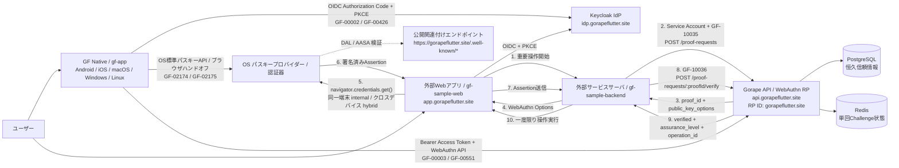
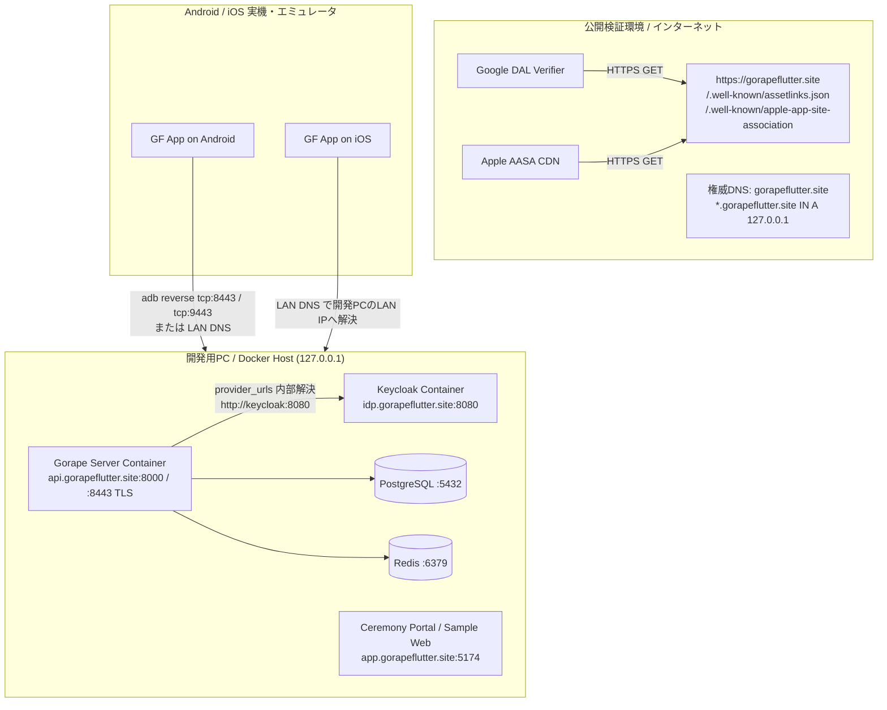
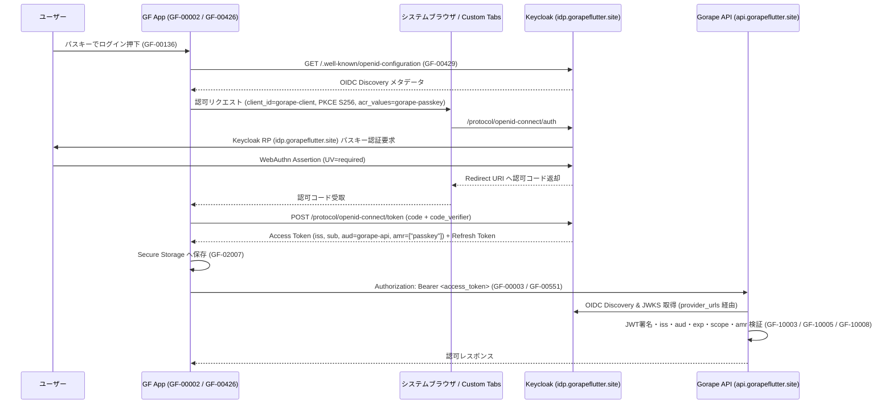
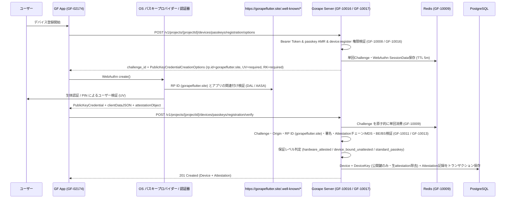
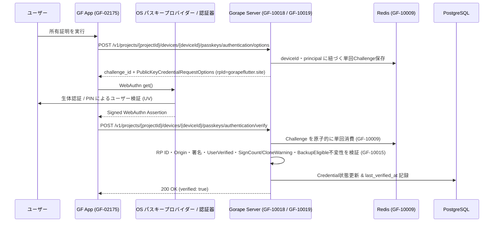
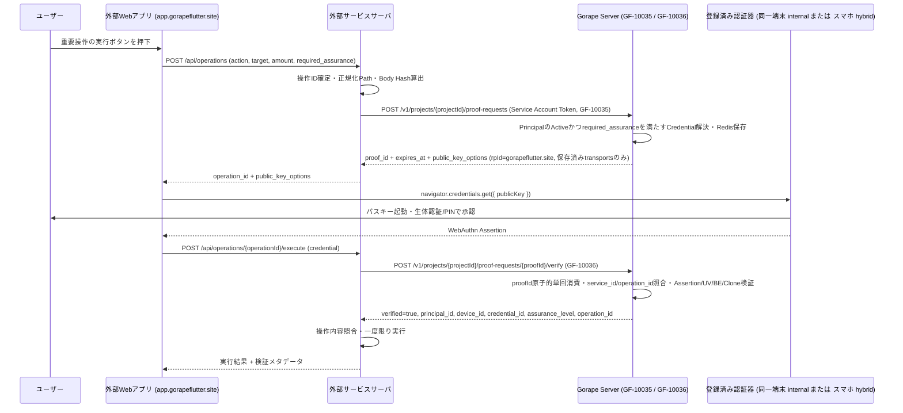

# Gorapeflutter 要件定義・基本設計・実装仕様書

この文書は、`gf-app`（GF Native）、`gorape`（Gorape Server）、および外部サービス連携サンプル（`gf-sample-backend` / `gf-sample-web`）の基本設計・ドメイン構成・ネットワーク構成・認証/登録/所有証明シーケンス・保証レベル・プラットフォーム対応状況を定義します。すべての処理は GF ID（[GF-00001](https://github.com/GorapeFlutter/gf-app/blob/main/lib/app.dart#L39)〜[GF-02186](https://github.com/GorapeFlutter/gf-app/blob/main/lib/back/usecase/connection.dart#L39)、[GF-10001](https://github.com/Gorapeflutter/gorape/blob/main/pkg/server/base.go#L13)〜[GF-10044](https://github.com/Gorapeflutter/gorape/blob/main/pkg/config/base.go#L277)）によってソースコードへ追跡可能です。

---

## 1. ドメイン設計（`gorapeflutter.site`）

公式開発・検証用ドメインとして `gorapeflutter.site` を採用しつつ、設定ファイル・環境変数・`--dart-define`・UI設定画面から任意の独自ドメインへ変更可能な構成を維持します（[GF-00114](https://github.com/GorapeFlutter/gf-app/blob/main/lib/config/connection.dart#L16), [GF-00115](https://github.com/GorapeFlutter/gf-app/blob/main/lib/config/connection.dart#L43), [GF-02186](https://github.com/GorapeFlutter/gf-app/blob/main/lib/back/usecase/connection.dart#L39), [GF-10010](https://github.com/Gorapeflutter/gorape/blob/main/pkg/server/repository/webauthn.go#L100), [GF-10011](https://github.com/Gorapeflutter/gorape/blob/main/pkg/server/repository/webauthn.go#L836), [GF-10037](https://github.com/Gorapeflutter/gorape/blob/main/pkg/config/base.go#L194)）。

| FQDN | 用途 | 採否・設計判断 |
|---|---|---|
| `gorapeflutter.site` | プロジェクト共通ドメイン・WebAuthn RP ID・公開関連付けファイル配信 | **採用**: `webauthn.rp_id: gorapeflutter.site`。eTLD+1 の親ドメインであるため `*.gorapeflutter.site` 配下の全サブドメイン Origin と整合し、Keycloak RP (`idp.gorapeflutter.site`) と信頼境界を分離します。`/.well-known/assetlinks.json` および `/.well-known/apple-app-site-association` の公開先となります。 |
| `idp.gorapeflutter.site` | Keycloak / OIDC Provider | **採用**: OIDC Issuer（ローカル開発既定 `https://idp.gorapeflutter.site:9443/realms/gorape`、公開検証・本番例 `https://idp.gorapeflutter.site/realms/gorape`）。HTTP :8080 は管理・内部接続用で、discovery の issuer ではありません。 |
| `api.gorapeflutter.site` | Gorape API | **採用**: Gorape REST API エンドポイント（ローカルHTTPS既定 `https://api.gorapeflutter.site:8443`、ローカルHTTP `http://api.gorapeflutter.site:8000`、公開/OpenAPI `https://api.gorapeflutter.site`）。 |
| `app.gorapeflutter.site` | ネイティブアプリ関連の公開設定・ブラウザセレモニーポータル | **採用**: Linux ブラウザハンドオフ用セレモニーページ（`https://app.gorapeflutter.site:5174/passkey-ceremony.html`）および OIDC コールバック等の Origin として利用します。 |
| `rp.gorapeflutter.site` | WebAuthn RP関連エンドポイント候補 | **不採用（既存コンポーネントへ統合）**: WebAuthn RP の REST API は `api.gorapeflutter.site` が提供し、DAL/AASA は RP ID 自体（`https://gorapeflutter.site/.well-known/...`）に配置する標準仕様であるため、不要な独立サービスは追加しません（`rp_origins` への追加自体は設定ファイルから任意に可能）。 |

---

## 2. システム構成図



---

## 3. ネットワーク構成図（ローカル開発環境と公開検証環境）

`*.gorapeflutter.site` はワイルドカードDNSにより `127.0.0.1` へ名前解決されます。一方、Android Credential Manager（Google）および Apple Associated Domains（Apple CDN）による関連付けファイル取得は外部インターネットから `https://gorapeflutter.site/.well-known/...` へ直接アクセスするため、ローカル開発環境と公開検証環境を明確に区別します。



- **ローカル開発環境の注意点**:
  - `127.0.0.1` は接続元端末自身を指します。Android 実機・エミュレータでは `./scripts/run-android.sh` が `adb reverse tcp:8443 tcp:8443` と `adb reverse tcp:9443 tcp:9443` を設定し、端末のHTTPS API/OIDC通信を開発PCへ転送します。KeycloakのHTTP :8080 endpointはdiscoveryでHTTPS :9443 issuerを返します。
  - `adb reverse` を使わない Android 実機や iOS 実機から開発PCへ接続する場合は、LAN内DNS（dnsmasq 等）で `idp.gorapeflutter.site` と `api.gorapeflutter.site` を開発PCのLAN IPへ解決し、そのLAN IPを `./scripts/generate-local-tls.sh --host <LAN_IP>` でTLS証明書SANに追加します。
  - TLS証明書の検証無効化（`InsecureSkipVerify` 等）による回避は全面的に禁止しています。

---

## 4. 認証・登録・所有証明シーケンス

### 4.1 OIDC認証シーケンス（[GF-00002](https://github.com/GorapeFlutter/gf-app/blob/main/lib/back/controller/auth.dart#L93) / [GF-10003](https://github.com/Gorapeflutter/gorape/blob/main/pkg/server/share/base.go#L15) / [GF-10005](https://github.com/Gorapeflutter/gorape/blob/main/pkg/server/usecase/project.go#L42) / [GF-10006](https://github.com/Gorapeflutter/gorape/blob/main/pkg/server/usecase/project.go#L63)）

Keycloak（`idp.gorapeflutter.site`）で OIDC Authorization Code + PKCE（`S256`）によりユーザー認証を行い、発行された **Access Token** のみを Gorape API（`api.gorapeflutter.site`）へ送信します（ID Token は API へ送信しません）。デバイス登録・所有証明には `amr: ["passkey"]` クレームが必要です（[GF-10008](https://github.com/Gorapeflutter/gorape/blob/main/pkg/server/usecase/device.go#L146)）。



### 4.2 デバイス登録シーケンス（[GF-02174](https://github.com/GorapeFlutter/gf-app/blob/main/lib/back/usecase/passkey_device.dart#L56) / [GF-10012](https://github.com/Gorapeflutter/gorape/blob/main/pkg/server/repository/webauthn.go#L331) / [GF-10013](https://github.com/Gorapeflutter/gorape/blob/main/pkg/server/repository/webauthn.go#L370) / [GF-10016](https://github.com/Gorapeflutter/gorape/blob/main/pkg/server/usecase/passkey_device.go#L92) / [GF-10017](https://github.com/Gorapeflutter/gorape/blob/main/pkg/server/usecase/passkey_device.go#L152)）



### Android Credential Providerの境界

Androidのデバイス登録はAndroidXの`CredentialProviderService` contractを使います。Flutterのpasskey adapterが標準Credential Manager create/get requestを送り、Provider選択とユーザー検証UIはAndroid OSが表示します。GF Hardware PasskeysはGorape RP IDだけを扱い、標準WebAuthn `PublicKeyCredential`、authenticator data、COSE key、CBOR attestation objectを返します。GF独自実装はAndroid Keystore内でのP-256鍵生成と`android-key` attestation statementの構成であり、独自のWebAuthn wire formatやOS chooser UIを定義するものではありません。Keycloak login用RP/credentialとは別経路です。現在のProviderは`internal`のみを広告します。transportとクロスデバイスflowの実装・実機検証が完了するまではCDA/hybrid対応と扱いません。

### 4.3 デバイス認証（所有証明・外部サービス操作承認）シーケンス

#### (a) GF App 内の所有証明シーケンス（[GF-02175](https://github.com/GorapeFlutter/gf-app/blob/main/lib/back/usecase/passkey_device.dart#L156) / [GF-10014](https://github.com/Gorapeflutter/gorape/blob/main/pkg/server/repository/webauthn.go#L495) / [GF-10015](https://github.com/Gorapeflutter/gorape/blob/main/pkg/server/repository/webauthn.go#L509) / [GF-10018](https://github.com/Gorapeflutter/gorape/blob/main/pkg/server/usecase/passkey_device.go#L313) / [GF-10019](https://github.com/Gorapeflutter/gorape/blob/main/pkg/server/usecase/passkey_device.go#L379)）



#### (b) 外部サービス向け操作結合承認シーケンス（同一端末 `internal` / クロスデバイス `hybrid` 対応、[GF-10035](https://github.com/Gorapeflutter/gorape/blob/main/pkg/server/usecase/passkey_device.go#L423) / [GF-10036](https://github.com/Gorapeflutter/gorape/blob/main/pkg/server/usecase/passkey_device.go#L497)）



---

## 5. API仕様

- OpenAPI 定義（`gorape/docs/openapi/openapi.yaml`）の `servers`:
  - `https://api.gorapeflutter.site`（公開検証・本番環境）
  - `https://api.gorapeflutter.site:8443`（ローカルHTTPS開発環境）
  - `http://api.gorapeflutter.site:8000`（ローカルHTTP開発環境）

### 5.1 GF Native向けWebAuthn API
- `POST /v1/projects/{projectId}/devices/passkeys/registration/options`（[GF-10016](https://github.com/Gorapeflutter/gorape/blob/main/pkg/server/usecase/passkey_device.go#L92)）
- `POST /v1/projects/{projectId}/devices/passkeys/registration/verify`（[GF-10017](https://github.com/Gorapeflutter/gorape/blob/main/pkg/server/usecase/passkey_device.go#L152)）
- `POST /v1/projects/{projectId}/devices/{deviceId}/passkeys/authentication/options`（[GF-10018](https://github.com/Gorapeflutter/gorape/blob/main/pkg/server/usecase/passkey_device.go#L313)）
- `POST /v1/projects/{projectId}/devices/{deviceId}/passkeys/authentication/verify`（[GF-10019](https://github.com/Gorapeflutter/gorape/blob/main/pkg/server/usecase/passkey_device.go#L379)）
- `POST /v1/passkeys/browser/options`（[GF-10020](https://github.com/Gorapeflutter/gorape/blob/main/pkg/server/usecase/passkey_device.go#L185)）
- `POST /v1/passkeys/browser/registration/verify`（[GF-10021](https://github.com/Gorapeflutter/gorape/blob/main/pkg/server/usecase/passkey_device.go#L173)）
- `POST /v1/passkeys/browser/authentication/verify`（[GF-10022](https://github.com/Gorapeflutter/gorape/blob/main/pkg/server/usecase/passkey_device.go#L397)）

### 5.2 外部サービス向け検証API
- **GF-API-01：Challenge発行** `POST /v1/projects/{projectId}/proof-requests`（[GF-10035](https://github.com/Gorapeflutter/gorape/blob/main/pkg/server/usecase/passkey_device.go#L423)）
  - 必要権限：`proof:request`（Keycloakロール `gorape-service`）
- **GF-API-02：Assertion検証** `POST /v1/projects/{projectId}/proof-requests/{proofId}/verify`（[GF-10036](https://github.com/Gorapeflutter/gorape/blob/main/pkg/server/usecase/passkey_device.go#L497)）
  - 必要権限：`proof:verify`（Keycloakロール `gorape-service`）

---

## 6. Attestation保証レベルマトリクス

保証レベルは検証済みのサーバー側証拠だけから導出し、clientが送るplatform名では昇格しません。登録時・認証時・外部向け所有証明で同じpolicyを適用します。

| 保証レベル (`assurance_level`) | 判定条件 | 高保証要求サービス (`hardware_attested`) | 通常要求サービス (`standard_passkey`) |
|---|---|---|---|
| `hardware_attested` | 登録検証成功、`BE=0`（単一デバイス固定）、かつ検証済みハードウェア証拠: locked/verified bootを伴う`android-key` TEE/StrongBox、Apple rootへchainする`apple` anonymous attestation、`tpm` AIK chain、`fido-u2f` chain、またはMDSの`keyProtection`が`hardware`/`tee`/`secure_element`/`smart_card` | **許可** | **許可** |
| `device_bound_unattested` | 登録検証成功、`BE=0`、ハードウェア証拠なし（`fmt=none`、`packed`、self attestation） | **拒否** | **許可** |
| `standard_passkey` | 登録検証成功かつ`BE=1`（同期可能パスキー）。ハードウェアstatementが併存しても常にこのレベル | **拒否** | **許可** |
| `rejected` | 検証失敗、MDS status不許可、失効、CloneWarning検知 | **拒否** | **拒否** |

`packed`とself attestationだけではハードウェア鍵のnon-exportable性を証明しません。`fido_mds_verified`はmetadata検証の記録であり、それ自体はハードウェア保護を意味しません。`BE`はcredentialごとに不変で、`BE=0`かつ`BS=1`、または登録後の`BE`変更は拒否します。

### 6.1 サービス保証policy

```yaml
attestation:
  webauthn:
    assurance:
      required: hardware_attested      # device_bound_unattested / standard_passkey も指定可能
      allow_synced_passkeys: false     # hardware_attested では false 必須
      hardware_formats: [android-key, apple, tpm, fido-u2f]
```

Gorapeは起動時に整合性を検証します。`hardware_attested`は`allow_synced_passkeys: false`と、ハードウェア対応formatまたはFIDO MDSのいずれかを必須とします。外部向け所有証明要求は`required_assurance`を引き上げられますが、サービスpolicyを下げることはできません。`user_verification`は`required`に固定します。

### 6.2 MDSと失効の再評価

MDS対象credentialではAAGUIDを保存し、assertionごとに現在の署名済みMDSでauthenticatorを再評価します。entry欠落や不許可statusはcredentialを`rejected`へ降格します。leaf attestation certificateを保持し失効確認が有効な場合、設定済みcache TTLの範囲でCRL/OCSPを再確認します。再評価結果と`last_evaluated_at`は永続化されます。network failureや未知statusは高保証判断ではfail closedです。

### 6.3 クロスデバイス認証 (CDA)

CDA（`hybrid`）は認証器のcapabilityであり、RPのpolicyではありません。Gorapeは登録時に認証器が返したtransportsを保存し、そのまま返します。保存値が空ならhintを付けません。Gorapeは`allowCredentials`へ`hybrid`や`internal`を注入しません。CDAを広告していない認証器をhintでCDA対応にはできません。gf-appがOS keystore（Apple Secure Enclave、Android Keystore、Windows CNG/TPM）に生成するローカル鍵は、FIDO credentialのassertion代用にはなりません。

---

## 7. プラットフォーム別対応マトリクスと検証状況

| プラットフォーム | OIDCログイン | パスキー登録・認証 | 同一端末認証 (`internal`) | クロスデバイス認証 (`hybrid` 認証器側/RP側) | WebAuthn RP ID / Origin | 関連付け設定・検証状況 |
|---|---|---|---|---|---|---|
| **Android** | 対応 (`flutter_appauth`, `com.gorapeflutter.gfapp:/oauth2redirect`) | 対応 (Credential Manager) | 対応 (Bluetooth不要) | 対応 (スマホ側認証器として動作可能) | `gorapeflutter.site` / `android:apk-key-hash:<sha256-base64url>` | `android/app/src/main/res/values/strings.xml` と `config/well-known/assetlinks.json` を構成済み。Googleによる公開DAL取得は `https://gorapeflutter.site/.well-known/assetlinks.json` の外部HTTPS公開後に実機検証が必要 |
| **iOS** | 対応 (`flutter_appauth`, `com.gorapeflutter.gfapp:/oauth2redirect`) | 対応 (AuthenticationServices) | 対応 (Bluetooth不要) | 対応 (iPhone側認証器として動作可能) | `gorapeflutter.site` / `https://gorapeflutter.site` | `ios/Runner/Runner.entitlements` (`webcredentials:gorapeflutter.site`) と `config/well-known/apple-app-site-association.example` を構成済み。Apple Team ID設定・AASA公開・実機ビルドは**未検証** |
| **macOS** | 対応 (`flutter_appauth`, `com.gorapeflutter.gfapp:/oauth2redirect`) | 対応 (AuthenticationServices) | 対応 (Touch ID等、Bluetooth不要) | 対応 (QR / hybrid 要求側) | `gorapeflutter.site` / `https://gorapeflutter.site` | `macos/Runner/*.entitlements` (`webcredentials:gorapeflutter.site`) を構成済み。Apple Team ID設定・AASA公開・実機ビルドは**未検証** |
| **Windows** | 対応 (システムブラウザ + PKCE, `http://127.0.0.1:8401/oauth2redirect`) | 対応 (Windows WebAuthn API `webauthn.dll`) | 対応 (Windows Hello PIN/生体認証、Bluetooth不要) | 対応 (Windows WebAuthn QR / hybrid) | `gorapeflutter.site` / `https://gorapeflutter.site` | コード・単体テスト実装済み。ローカルDevice鍵はCNG Platform Crypto Provider（利用可能ならTPM、`windows/runner/windows_native_keys.cpp`）を利用。Windows実機での Windows Hello TPM Attestation は**未検証** |
| **Linux** | 対応 (システムブラウザ + PKCE, `http://127.0.0.1:8401/oauth2redirect`) | 対応 (システムブラウザハンドオフ `LinuxBrowserPasskeyRepository`) | 対応 (プラットフォーム認証器 / USB FIDO2キー、Bluetooth不要) | 対応 (ブラウザの hybrid QR フロー) | `gorapeflutter.site` / `https://app.gorapeflutter.site:5174` | 単回Capability ([GF-10020](https://github.com/Gorapeflutter/gorape/blob/main/pkg/server/usecase/passkey_device.go#L185)〜[GF-10022](https://github.com/Gorapeflutter/gorape/blob/main/pkg/server/usecase/passkey_device.go#L397)) と `web/passkey-ceremony.html` で実装・単体テスト検証済み。Linuxデスクトップ実機は**未検証** |

---

## 8. RP ID 変更時の移行・再登録手順

WebAuthn Credential は登録時の `rp_id`（`authenticatorData.rpIdHash = SHA-256(rpId)`）に暗号学的に束縛されます。そのため、旧 RP ID（`gorapeflutter.github.io` や `localhost`）から `gorapeflutter.site`（または本番の独自ドメイン）へ変更した場合、旧 RP ID で登録されたパスキーは新 RP ID の認証要求に対して使用できません。

1. **サーバー設定の更新**: `gorape/etc/server.yaml`（または `etc/server.yaml.docker`）の `webauthn.rp_id`、`rp_origins`、`portal_origin`、`browser_api_origin`、`web_origins` を新しいドメインへ更新します（[GF-10010](https://github.com/Gorapeflutter/gorape/blob/main/pkg/server/repository/webauthn.go#L100), [GF-10011](https://github.com/Gorapeflutter/gorape/blob/main/pkg/server/repository/webauthn.go#L836)）。
2. **公開関連付けファイルの配置**: `https://<new-rp-id>/.well-known/assetlinks.json` および `https://<new-rp-id>/.well-known/apple-app-site-association` を公開HTTPSサーバーに配置します。
3. **クライアント設定の更新**: Android の `strings.xml`（`asset_statements`）および iOS/macOS の Entitlements（`webcredentials:<new-rp-id>`）を新しい RP ID に合わせてビルドします。
4. **旧デバイスの失効と再登録**:
   - GF App のデバイス詳細画面または管理画面（`DELETE /v1/projects/{projectId}/devices/{deviceId}`, [GF-00007](https://github.com/GorapeFlutter/gf-app/blob/main/lib/back/usecase/device.dart#L247) / [GF-00525](https://github.com/GorapeFlutter/gf-app/blob/main/lib/back/repository/gorape.dart#L268)）から、旧 RP ID で登録されたデバイスを失効（Revoke）します。
   - デバイス登録画面から新規にパスキー登録（`POST /v1/projects/{projectId}/devices/passkeys/registration/options` → `/verify`, [GF-02174](https://github.com/GorapeFlutter/gf-app/blob/main/lib/back/usecase/passkey_device.dart#L56) / [GF-10016](https://github.com/Gorapeflutter/gorape/blob/main/pkg/server/usecase/passkey_device.go#L92) / [GF-10017](https://github.com/Gorapeflutter/gorape/blob/main/pkg/server/usecase/passkey_device.go#L152)）を実行します。
   - 既存Credentialは移行できません。サーバー側には公開鍵しか残らないため、再登録が必須です。

### 8.1 配備状況と未検証項目

- `*.gorapeflutter.site`（`hoge`、`api`、`idp`、`app`、`rp`、`local`）はローカル開発用に`127.0.0.1`へ解決されます。
- apex `gorapeflutter.site` には現在**A/AAAAレコードがありません**（NS/SOAのみ）。そのため、Google/Apple CDNによる`https://gorapeflutter.site/.well-known/assetlinks.json`および`https://gorapeflutter.site/.well-known/apple-app-site-association`の外部取得と、DNS-01を含む公開TLS証明書発行は、DNS制御権が得られるまで**実施不可・未検証**です。
- Androidリリース署名鍵はこの環境に無く、DALはdebug証明書fingerprintのみを含みます。
- Xcode projectのApple Team IDとAASA本番公開は**未検証**です。provisioning profileは出荷署名identityと一致させる必要があります。
- Android Credential Managerの`fmt=none`、Apple anonymous attestation、Windows TPM attestation、CDA `hybrid`の実挙動は、この環境では**未検証**です。回避策としてTLS証明書検証を無効化してはいけません。
