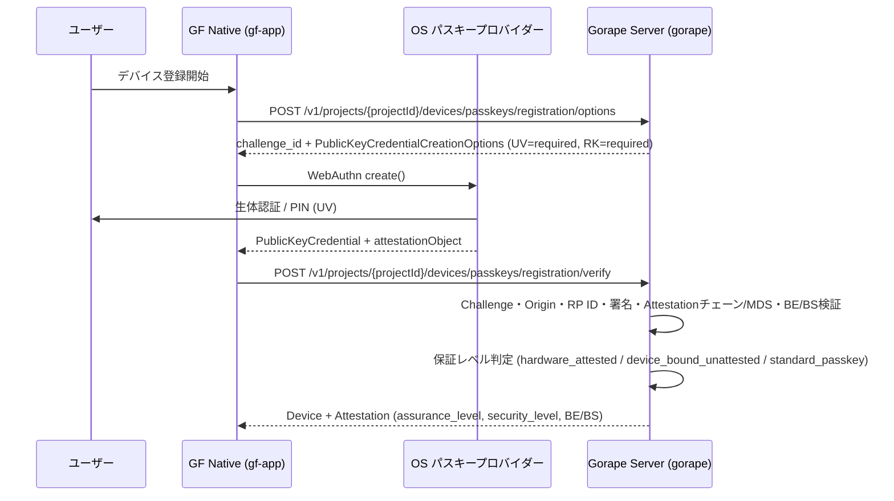
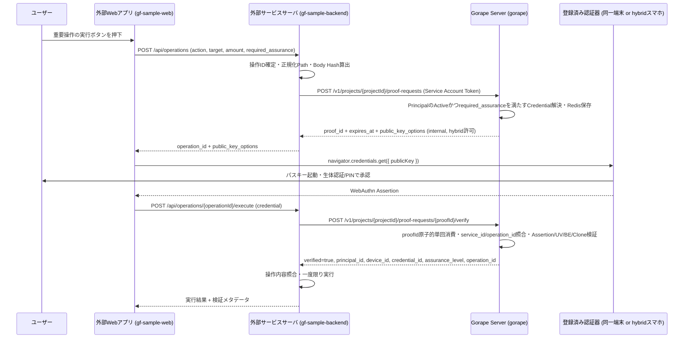

# Gorapeflutter 要件定義・基本仕様・実装仕様書

この文書は、`gf-app`（GF Native）、`gorape`（Gorape Server）、および外部サービス連携サンプル（`gf-sample-backend` / `gf-sample-web`）のアーキテクチャ・保証レベル・API仕様・PF対応マトリクスを定義します。

---

## 1. アーキテクチャと全体構成

```mermaid
flowchart LR
    User[ユーザー] --> Native[GF Native / Flutter]
    Native -->|OIDC Authorization Code + PKCE| Keycloak[Keycloak IdP]
    Native -->|OS標準パスキーAPI| Authn[OS パスキープロバイダー / 認証器]
    Native -->|WebAuthn登録 Options / Verify| Gorape[Gorape Server / WebAuthn RP]

    User --> Vue[外部Webアプリ / gf-sample-web]
    Vue -->|OIDC + PKCE| Keycloak
    Vue -->|1. 重要操作開始| Svc[外部サービスサーバ / gf-sample-backend]
    Svc -->|2. Service Account + GF-API-01<br/>POST /proof-requests| Gorape
    Gorape -->|3. proof_id + public_key_options| Svc
    Svc -->|4. WebAuthn Options| Vue
    Vue -->|5. navigator.credentials.get()<br/>同一端末 or クロスデバイス hybrid| Authn
    Authn -->|6. 署名済みAssertion| Vue
    Vue -->|7. Assertion送信| Svc
    Svc -->|8. GF-API-02<br/>POST /proof-requests/:proofId/verify| Gorape
    Gorape -->|9. verified + assurance_level + operation_id| Svc
    Svc -->|10. 一度限り操作実行| Vue
```

---

## 2. 登録・外部サービス認証シーケンス

### 2.1 Credential登録シーケンス（GF-REG-01〜06）



### 2.2 外部サービス向け操作承認シーケンス（GF-AUTH-01〜06）



---

## 3. API仕様

### 3.1 GF Native向け既存WebAuthn API
- `POST /v1/projects/{projectId}/devices/passkeys/registration/options`
- `POST /v1/projects/{projectId}/devices/passkeys/registration/verify`
- `POST /v1/projects/{projectId}/devices/{deviceId}/passkeys/authentication/options`
- `POST /v1/projects/{projectId}/devices/{deviceId}/passkeys/authentication/verify`

### 3.2 外部サービス向け検証API（新規実装）
- **GF-API-01：Challenge発行**
  - `POST /v1/projects/{projectId}/proof-requests`
  - 必要権限：`proof:request`（Keycloakロール `gorape-service`）
  - 要求JSON：`service_id`, `principal_id`（Principal UUIDまたはOIDC `sub`）, `operation_id`, `method`, `path`, `body_hash`, `required_assurance`, `credential_id`（任意）
  - 応答JSON：`proof_id`, `expires_at`, `public_key_options`
- **GF-API-02：Assertion検証**
  - `POST /v1/projects/{projectId}/proof-requests/{proofId}/verify`
  - 必要権限：`proof:verify`（Keycloakロール `gorape-service`）
  - 要求JSON：`service_id`, `operation_id`, `credential`
  - 応答JSON：`verified`, `principal_id`, `device_id`, `credential_id`, `assurance_level`, `operation_id`

---

## 4. Attestation保証レベルマトリクス（§7）

| 保証レベル (`assurance_level`) | 判定条件 | 高保証要求サービス (`hardware_attested`) | 通常要求サービス (`standard_passkey`) |
|---|---|---|---|
| `hardware_attested` | `BE=0`（単一デバイス固定）かつ、信頼済みAttestation（`android-key` TEE/StrongBox+RootOfTrust、`tpm` AIK証明、`apple` チェーン、FIDO MDS検証済みハードウェア鍵）が確認された場合 | **許可**（`hybrid` クロスデバイス利用時も維持） | **許可** |
| `device_bound_unattested` | `BE=0` だが、`fmt=none` または Self Attestation によりハードウェア保護が未検証の場合 | **拒否** | **許可** |
| `standard_passkey` | `BE=1`（同期可能パスキー）を含む有効なWebAuthn Credential | **拒否** | **許可** |
| `rejected` | 証跡不正・ポリシー不一致・失効済み・CloneWarning検知 | **拒否** | **拒否** |

---

## 5. プラットフォーム対応マトリクスとセキュリティ制約

| プラットフォーム | OSパスキー連携 | 典型的なAttestation形式 | 保証できる範囲・残存制約 |
|---|---|---|---|
| **Android** | Credential Manager | `android-key` または `none` | Google Password Managerは同期パスキー（`BE=1`, `fmt=none` → `standard_passkey`）を返す場合がある。`android-key` + `BE=0` + TEE/StrongBox検証時のみ `hardware_attested` |
| **iOS** | AuthenticationServices | `apple` または `none` | iCloud Keychain同期パスキーは `BE=1` のため `standard_passkey`。実機検証は未実施 |
| **macOS** | AuthenticationServices | `apple` または `none` | Secure Enclave利用有無および `BE=0` の証跡に依存。実機検証は未実施 |
| **Windows** | Windows WebAuthn API (`webauthn.dll`) | `tpm` または `none` | Windows Hello TPMが `fmt=tpm` かつ `BE=0` を返し、AIK/MDS検証が通った場合に `hardware_attested`。実機検証は未実施 |
| **Linux** | ブラウザハンドオフ (`LinuxBrowserPasskeyRepository`) | 認証器依存 (`packed`, `fido-u2f`, `none`) | FIDO2ハードウェアセキュリティキー利用時は `BE=0` + MDS/Trust Anchorで `hardware_attested` 可能 |

### 保証できない条件・残存リスク
1. **パスキープロバイダーの選択権**：OS標準パスキーAPIでは、ユーザーがサードパーティ製パスワードマネージャーや同期パスキープロバイダーを選択できるため、GF Native側からStrongBox/TPM保存を強制することはできません。そのため、Gorape Server側で `BE=0` とAttestation証明書を検証し、満たさないものを `hardware_attested` として扱わないことで統制します。
2. **クロスデバイス認証時のブラウザ端末識別**：`hybrid` Transportでは署名認証器の所持とユーザー検証（UV）は保証されますが、Webブラウザを動かしているPC自体の物理的一意性は保証対象外です。
3. **OS初期化後の物理端末再識別**：秘密鍵消失後に同一物理端末であることを再識別する恒久IDは保持せず、Credential単位で失効・再登録を行います。
